# :computer: Yet Another Fancy Prompt 🖥️

[![made-with-bash][badge-bash]][bash]
[![made-with-zsh][badge-zsh]][zsh]
[![made-with-powershell][badge-powershell]][powershell]
![version][badge-version]
![themes][badge-themes]

[badge-bash]: https://img.shields.io/badge/Made%20with-Bash-1f425f.svg
[badge-zsh]: https://img.shields.io/badge/Made%20with-Zsh-1f425f
[zsh]: https://zsh.sourceforge.io/
[badge-powershell]: https://img.shields.io/badge/Made%20with-PowerShell-5391FE.svg?logo=powershell
[badge-version]: https://img.shields.io/badge/version-0.3.5-green
[badge-themes]: https://img.shields.io/badge/themes-8A2BE2?logo=educative
[bash]: https://www.gnu.org/software/bash/
[powershell]: https://docs.microsoft.com/powershell/

<!--
## What is yafp?


-->

<!-- markdownlint-disable MD026 -->
## 🎂 yafp Turns 6 — Still Alive!


### UNIX™️

#### :penguin: [Linux](https://kernel.org/)

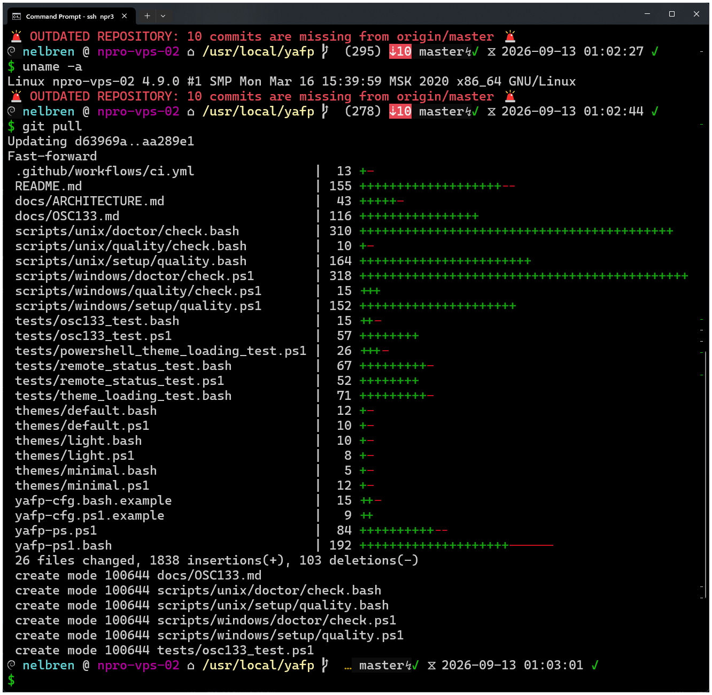

####  [macOS](https://www.apple.com/la/os/macos/)

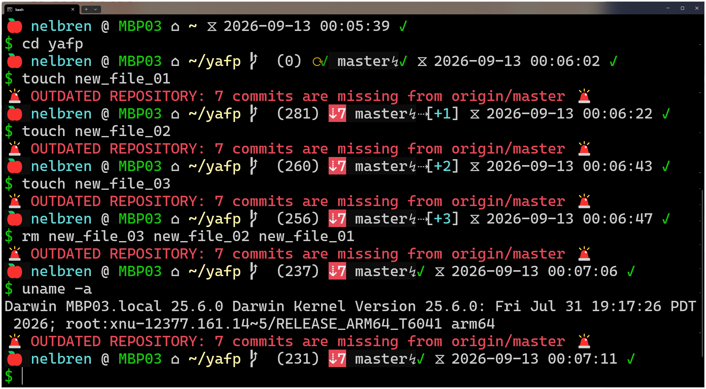

### WINDOWS

#### :window: [Cygwin](https://www.cygwin.com/)

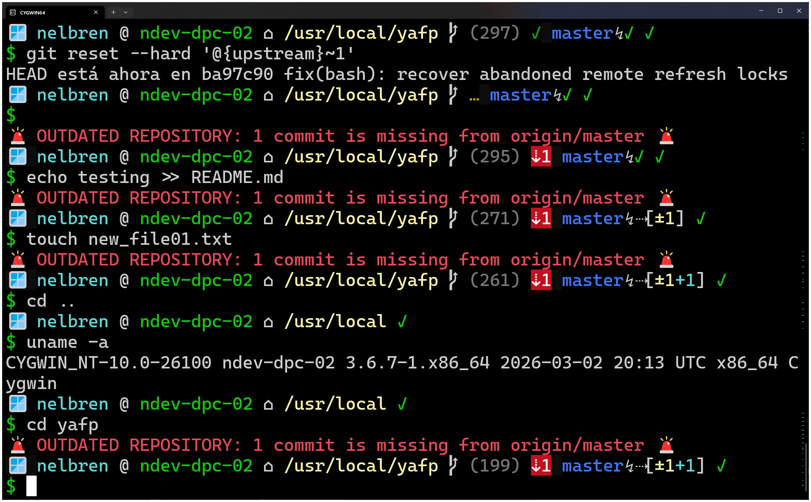

#### :window: [Git Bash](https://git-scm.com/download/win)

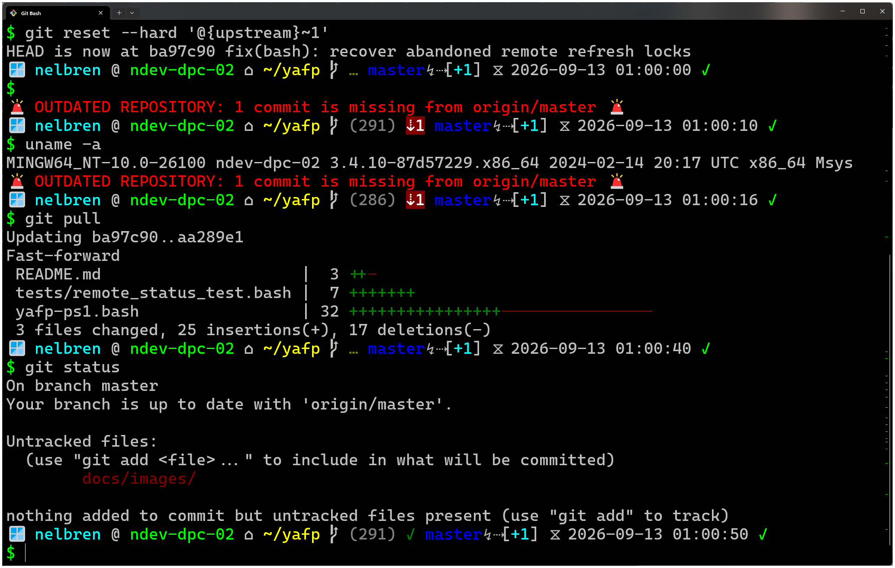

#### :window: [PowerShell](https://learn.microsoft.com/es-es/powershell/scripting/install/installing-powershell-on-windows?view=powershell-7.5)

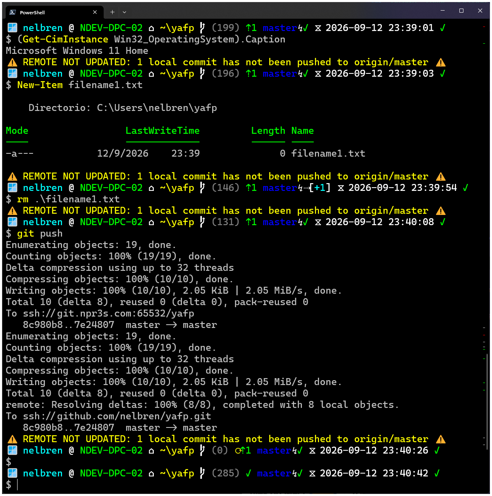

---

### zsh on macOS and Linux

YAFP supports zsh 5.9 or later alongside Bash and PowerShell. It uses a native
engine and the same `default`, `minimal`, and `light` themes and configuration
options. Git remains optional. The Bash-style option assignments shown below
also apply to `yafp-cfg.zsh`.

From your YAFP checkout, create the personal configuration:

```zsh
cp yafp-cfg.zsh.example yafp-cfg.zsh
```

Add the following line to your `~/.zshrc`, using your checkout's absolute path:

```zsh
source /path/to/yafp/yafp-ps1.zsh
```

Load it in your existing zsh session with the same command. For a configuration
stored elsewhere, set `YAFP_CONFIG_FILE` to its absolute path before sourcing.
Personal `yafp-cfg.zsh` files are ignored by Git.

If you use Oh My Zsh, set `ZSH_THEME=""` and source YAFP after the framework.
YAFP owns the visible prompt; other successful `precmd`, `preexec`, and
`zshexit` hooks remain registered. It enables `PROMPT_PERCENT` and
`PROMPT_SUBST` and disables `PROMPT_BANG`. Its implementation options, including
array indexing, stay local to YAFP functions. Prompt data is expanded once,
so paths and names containing substitution syntax cannot execute commands.

The zsh implementation includes the remote checks, staged and remote banners,
virtual environments, previous-command exit status, execution statistics,
OSC 133, reload, development timing, and the `yafp-*` helper commands described
below. It does not invoke Bash to render the prompt. Remote workers are silent
and run in the background; the next prompt reads their cached result.

Run the zsh syntax, logic, local Git, and interactive terminal tests with:

```bash
bash scripts/unix/quality/zsh.bash
```

The test runner requires zsh and Python 3; Python is not a prompt dependency.
The normal Unix quality command also runs these checks when zsh is installed.
Set `YAFP_REQUIRE_ZSH=1` to require the runtime, as Linux and macOS CI do.
The existing Unix doctor continues to diagnose Bash configuration and profiles.

## :art: Styles

Bash and zsh use `` for macOS in both server and client OS indicators
across the `default`, `minimal`, and `light` themes.

### :bulb: Colors change according to

#### :computer: Server type

- ##### :green_book: **Developer**

- ##### :closed_book: **Production**

#### :bust_in_silhouette: User type

- ##### :necktie: root (**`#`**)

- ##### :tshirt: normal user (**`$`**)

### :window: PowerShell themes

PowerShell now supports the `default`, `minimal`, and `light` themes. Select
one in `yafp-cfg.ps1` before loading `yafp-ps.ps1`:

```powershell
$global:YAFP_THEME = 'minimal'
```

If the selected theme does not exist, YAFP falls back to the `default` theme.

Set `YAFP_DARKC` to `1` to use darker background variants in the Bash and
PowerShell `default` and `minimal` themes. Set it to `0` for brighter
backgrounds:

```bash
YAFP_DARKC=1
```

```powershell
$global:YAFP_DARKC = 1
```

The option does not affect `light`, which renders without colored backgrounds,
including the separator spaces between prompt segments.

The previous-command error symbol and exit code use intense red text on a
transparent background in every theme. This command-status style is independent
from error banners, which retain their contrasting foreground and background.

### Git repository identity

In the Bash `default` theme, only the repository name uses the same yellow
highlight as its directory representation in PowerShell. The surrounding Git
symbols and metadata keep the Git block color.

The origin symbol distinguishes repositories by configuration:

| Symbol | Themes               | Meaning                                |
| ------ | -------------------- | -------------------------------------- |
| `↯`    | `light`              | The repository has a configured remote |
| `⚡`   | `default`, `minimal` | The repository has a configured remote |
| `⇣`    | All                  | The repository has no `origin` remote  |

The `light` and `minimal` themes render the branch name in blue in both Bash
and PowerShell, including when a remote countdown or status precedes it. In
`light`, the adjacent repository-origin symbol keeps the neutral color.

### Indicator blocks

Codex quota, machine resources, Git remote status, and Git change counters
use bracketed frames in every shell and theme: `↤[…]` for Codex and
`↦[…]` for the other indicators:

```text
USER↤[֍⣷5d9h]
HOST↦[⚙⣀▦⣶⇄⣦◉⣿]
↦[⣦✓🌐︎] main↯↦[-1±2+3]
```

`↤` associates the username with its Codex quota; `↦` associates the other
labels with their data. The arrows and brackets use the theme's
Git delimiter colors; each inner indicator retains its own severity color.
Codex keeps the reset countdown attached to its value, and resources keep
their configured separators. The Git remote countdown and status are adjacent
inside one frame: symbolic `↦[⣦✓🌐︎]` or numeric `↦[(175)✓🌐︎]`. Refresh,
tracking, warning, and error states use the same frame. Empty remote and
counter blocks produce no frame. The `light` theme retains its clean-worktree
check mark, while the other themes retain their existing clean-state behavior.
Counter labels and emoji remain theme-specific inside the common frame.
The remote frame touches the preceding Git marker, as in `↦[⣦✓🌐︎]`,
with a space after the frame before the branch name.

Remote and staged banners remain aligned with their corresponding indicators,
including when other counters appear before the staged count.

### Clock display

Set `YAFP_CLOCK` to `1` to display prompt timestamps or to `0` to hide them.
The option applies to every Bash and PowerShell theme.

For Bash, set the value in `yafp-cfg.bash`:

```bash
YAFP_CLOCK=1
```

For PowerShell, set the value in `yafp-cfg.ps1`:

```powershell
$global:YAFP_CLOCK = 1
```

### Development timing

Set `YAFP_DEVEL` to `1` to display the prompt construction time. A value of `0`
or an unset variable disables it. It works with every Bash and PowerShell theme.

For Bash, set the value in `yafp-cfg.bash`:

```bash
YAFP_DEVEL=1
```

For PowerShell, set the value in `yafp-cfg.ps1`:

```powershell
$global:YAFP_DEVEL = 1
```

The diagnostic line uses the same fields on both shells:

| Field     | Meaning                                      |
| --------- | -------------------------------------------- |
| `Total`   | Total prompt construction time               |
| `General` | General context time                         |
| `Git`     | Git context time                             |
| `Venv`    | Python virtual environment context time      |
| `Error`   | Previous command status calculation time     |
| `Timer`   | Remaining timer and orchestration overhead   |

The output maps those fields to `Total ms | ⚙️General 🌱Git 🐍Venv ❌Error
⚡Timer`.

Totals below 50 ms use `🚀` in green, totals from 50 through 199 ms use
`⏱️` with black text on an intense yellow background, and totals of 200 ms or
more use
`🐢` with intense white text on a red background.

### Background resource monitoring

YAFP can show CPU, RAM, swap, and used capacity on the volume containing
`HOME`, inside or outside a repository. Monitoring is disabled by default.
To enable it in Bash or zsh, add this to your personal configuration:

```bash
YAFP_RESOURCE_CHECK_INTERVAL=30
```

For PowerShell 7 on Windows, use:

```powershell
$global:YAFP_RESOURCE_CHECK_INTERVAL = 30
```

Then run `yafp-reload`. The interval accepts integers from `1` through `86400`
seconds; `0` disables monitoring. Invalid values also disable it without
printing prompt errors. Existing personal configurations are not modified.

All three themes attach the resource block directly to the hostname:

```text
HOST↦[C24% R74% S50% D93%]
```

The `↦[]` frame uses the same colors as the theme's Git change delimiters.
Each resource keeps its own usage color. Labels and values can be selected
independently in Bash/zsh:

```bash
YAFP_RESOURCE_LABEL_STYLE="unicode"  # letters (default) or unicode
YAFP_RESOURCE_VALUE_STYLE="symbols"  # percent (default) or symbols
```

In PowerShell, write the same options as follows:

```powershell
$global:YAFP_RESOURCE_LABEL_STYLE = 'unicode'
$global:YAFP_RESOURCE_VALUE_STYLE = 'symbols'
```

The four combinations produce the following output for the same sample:

```text
letters + percent: HOST↦[C24% R74% S50% D93%]
unicode + percent: HOST↦[⚙24% ▦74% ⇄50% ◉93%]
letters + symbols: HOST↦[C⣀ R⣶ S⣦ D⣿]
unicode + symbols: HOST↦[⚙⣀▦⣶⇄⣦◉⣿]
```

`C`/`⚙`, `R`/`▦`, `S`/`⇄`, and `D`/`◉` represent CPU, RAM, swap, and disk,
respectively. CPU appears first, and swap sits between RAM and disk to
highlight their relationship. All four modes and all three themes use this
order. Only Unicode + Braille (`unicode` + `symbols`) removes spaces between
resources. No space separates the hostname from `↦[`, and there is no inner
padding next to the brackets. The other three combinations separate resources
with spaces. Disabled monitoring renders no frame. Invalid styles fall back
to `letters` and `percent`.

Swap usage is relative to its total allocated capacity. Percentages are shown
as integers without decimal places. The `symbols` mode divides usage into
eight levels: 0–12% `⡀`, 13–24% `⣀`, 25–37% `⣄`, 38–49% `⣤`, 50–62% `⣦`,
63–74% `⣶`, 75–87% `⣷`, and 88–100% `⣿`. At 0%, the minimum cell `⡀` is used;
`yafp-resources` retains the used/total details for inspecting exact values.

Each resource uses a foreground color on a transparent background in every
theme:

| Resource       | Green | Yellow | Red  |
| -------------- | ----- | ------ | ---- |
| RAM, CPU, disk | ≤85%  | >85%   | >95% |
| Swap           | ≤10%  | >10%   | >30% |

Red takes precedence over yellow. Thresholds use the actual integer percentage
even in Braille mode; unavailable values appear in gray. The prompt omits
sample age to keep the host block compact. `yafp-resources` still reports age:
`17s` means seconds elapsed since sampling, rather than a countdown to the
next update. `~` inside the frame indicates a new sample in progress and
attaches directly to the last value, for example `↦[⚙⣷▦⣦⇄⡀◉⣿~]`.
The first sample displays `Resources: waiting for sample~`; an unavailable
sample reports `Resources: no valid sample`. Unavailable
metrics appear as `N/A`, never as an invented zero. A swap total of zero means
no swap/pagefile is allocated: this appears as `S0%` or `⇄0%`, or the
minimum cell in symbolic mode.

`yafp-resources` shows a plain summary with sample age, used/total RAM and swap
in MiB, and disk usage in KiB. During refresh, its age and marker are adjacent,
for example `⚙⣷▦⣦⇄⡀◉⣿ 17s~`. The space before sample age remains.
It does not wait for a pending sample to finish.
A worker starts during prompt rendering when the interval expires; a later
prompt reads its result. There is no persistent timer, and the line is not
redrawn while you type. The sample age identifies older data when a probe is
slow or fails. Each session has at most one resource worker; two terminals
keep independent samples. Reloading does not duplicate workers. In zsh, the
worker launches disowned with `&!`, so starting or finishing it does not emit
job notifications such as `[3] + done`.

macOS uses `sysctl`, `vm_stat`, two `top` samples one second apart, and `df`.
RAM is an estimate of occupied physical memory that excludes free, inactive,
and speculative pages; it can differ from Activity Monitor. Linux/WSL2 uses
`MemTotal - MemAvailable`, swap from `/proc/meminfo`, and two `/proc/stat`
samples 200 ms apart. Windows uses CIM/WMI and allocated pagefiles from a
PowerShell 7 thread job. In Git Bash, metrics without a native probe appear
as `N/A`; disk usage still uses `df`. Disk reports capacity, without measuring
I/O latency or saturation.

All probes run in the background with isolated input and output. Rendering
reads numeric data using shell builtins without running probes or querying
the network. Unix publishes samples atomically in a private session temporary
directory and removes it on normal exit. PowerShell keeps results in memory
and removes completed jobs. No repository files or metric histories are created.

On macOS, swap usage alone does not establish the cause of a slowdown. To
investigate memory pressure, Activity Monitor also considers the swap rate,
wired memory, and file cache:
[Apple memory guide](https://support.apple.com/guide/activity-monitor/view-memory-usage-actmntr1004/mac).

All prompt, diagnostic, and test messages are in English. Unavailable values
use `N/A` consistently in resource and Codex indicators.

### Background Codex quota

YAFP can display the remaining Codex quota for the ChatGPT account signed in
to the local Codex CLI (`codex`). This measures account quota, rather than
service uptime or the message allowance in the ChatGPT website. It uses the
official [Codex app-server account interface](https://learn.chatgpt.com/docs/app-server).
The feature is disabled by default and works independently of Git and machine
resource monitoring.

Add a configuration block to your personal Bash/zsh configuration:

```bash
# --- Codex account quota ---
YAFP_CODEX_CHECK_INTERVAL=300
YAFP_CODEX_VALUE_STYLE="symbols"  # percent (default) or symbols
```

For PowerShell 7 on Windows:

```powershell
# --- Codex account quota ---
$global:YAFP_CODEX_CHECK_INTERVAL = 300
$global:YAFP_CODEX_VALUE_STYLE = 'symbols'
```

Run `yafp-reload`. The interval accepts `1` through `86400` seconds; `0` or
an invalid interval disables checks and removes the indicator. Five minutes
is suggested to avoid frequent CLI startup. All three themes attach the block
directly to the username, preserving the host resource block:

```text
percent: USER↤[֍75%5d9h] @ HOST↦[⚙24% ▦74% ⇄50% ◉93%]
symbols: USER↤[֍⣷5d9h] @ HOST↦[⚙⣀▦⣶⇄⣦◉⣿]
```

The `↤[]` frame uses the Git change delimiter colors. The quota token uses a
transparent background and inclusive availability thresholds:

| Green | Yellow   | Red  |
| ----- | -------- | ---- |
| ≥50%  | 25–49%   | <25% |

Braille uses the same eight levels as resources, with fuller cells meaning
more quota available. Colors use the remaining integer percentage, even in
symbolic mode. `YAFP_CODEX_VALUE_STYLE` accepts `percent` or `symbols`;
invalid styles fall back to `percent`.

On its first check, the background worker locates `codex` and reads its account
state. Only ChatGPT authentication enables the quota request. Each refresh
checks authentication again, allowing a later login to recover automatically.
YAFP never opens a login flow or starts a conversation. To sign in yourself,
run `codex login`, then wait for the next check. Unix requires Python 3 only
when this optional integration is enabled; Windows uses native PowerShell.

The value is `100 - usedPercent`, rounded down, for the `codex` bucket. When
both primary and secondary windows are available, the smaller remaining
percentage wins. Other model buckets are ignored. The legacy single-bucket
response is supported. Missing windows are ignored; if neither is available,
the token is `֍N/A` in gray. A missing CLI, missing Python, logged-out or API-key
session, request error, or timeout also produces `֍N/A`, never a false 0%.

The value is immediately followed by the time until that same window resets,
without a separator: `֍75%5d9h` or `֍⣷5d9h`. Ties in remaining percentage select
the primary window. The compact countdown uses days/hours (`5d9h`),
hours/minutes (`9h30m`), minutes/seconds (`12m15s`), or seconds (`40s`), with
whole units rounded down. It uses the window's `resetsAt` timestamp and is
updated from cached data at every prompt, without an extra process or request.
An elapsed deadline displays `0s` until another quota sample arrives. A missing
or invalid reset timestamp omits the countdown while preserving the quota.

Requests have a ten-second deadline in the worker. Rendering reads the cached
result without waiting or accessing the network. The initial prompt can show
`֍N/A` until the result is collected at a later prompt. Each session keeps at
most one quota worker, and reloads reuse it. In zsh, the worker is disowned
at launch to suppress job notifications. There is no persistent polling timer
or redraw while typing. The last sample remains visible during a refresh;
a failed refresh replaces it with `֍N/A`.

Run `yafp-codex` for the cached state, remaining percentages per window, and
sample age in seconds. It does not wait for the pending request. Only numeric
quota values, reset timing, and a fixed status are cached. Account identifiers
and credentials are never stored in the sample or printed by YAFP.

### Remote repository checks

YAFP can periodically refresh the configured upstream without blocking the
prompt. Configure the cache lifetime in seconds before loading the prompt:

| Value             | Behavior                                      |
| ----------------- | --------------------------------------------- |
| `0`               | Disables remote checks completely             |
| Positive integer  | Enables checks using that interval in seconds |
| Not configured    | Defaults to 300 seconds                       |

For Bash, set the value in `yafp-cfg.bash`:

```bash
YAFP_REMOTE_CHECK_INTERVAL=300
```

For PowerShell, set the value in `yafp-cfg.ps1`:

```powershell
$global:YAFP_REMOTE_CHECK_INTERVAL = 300
```

Choose how the remaining interval is displayed with
`YAFP_REMOTE_COUNTDOWN_STYLE`. The default `numeric` value shows the exact
seconds as `(N)`. The `symbols` value shows one Braille cell that progressively
empties as the next check approaches:

```bash
YAFP_REMOTE_COUNTDOWN_STYLE="symbols"
```

```powershell
$global:YAFP_REMOTE_COUNTDOWN_STYLE = 'symbols'
```

The symbolic sequence is `⣿`, `⣷`, `⣶`, `⣦`, `⣤`, `⣄`, `⣀`, and `⡀`.
Each shape progresses through intense white, normal white, and dark gray before
repeating the cycle. The shape follows the remaining time, while the color
advances once whenever a new prompt is rendered. It does not update while the
prompt is idle. At zero, the countdown cell disappears and the existing `⟳`
refresh indicator communicates that the background check is running. The color
cycle uses only an integer increment and selection during rendering; it does not
start another timer or process.

When the cached result expires, YAFP starts a non-interactive `git fetch` in
the background. A later prompt render reads the result. Repositories without
an upstream do not produce a false outdated warning. If a branch has a
configured remote but no upstream reference, all themes show the yellow `⇡?`
indicator with `( ⚠ NO UPSTREAM: configure tracking before pushing )`.
On narrower terminals the banner becomes `( ⚠ NO UPSTREAM )`; if neither
banner fits, the compact indicator remains visible. `yafp-status` reports
`⇡? No upstream`. This local warning does not fetch, start a worker, show a
countdown, or claim a count of unpublished commits. Local-only repositories
with commits and detached HEAD do not show it. Setting
`YAFP_REMOTE_CHECK_INTERVAL=0` also disables this warning.

After `git init`, a repository without commits shows the yellow `○0`
indicator and `( ⚠ NO COMMITS: create the initial commit )`, or the compact
`( ⚠ NO COMMITS )` banner when space is limited. This warning takes precedence
over missing upstream tracking, works without a remote, and remains visible
while files are staged. The first commit clears it; a configured remote may
then trigger the no-upstream warning. Both warnings respect
`YAFP_REMOTE_CHECK_INTERVAL=0` and never start background jobs.
Bash and zsh detect `git init` in the current directory even if an earlier
prompt cached it as a non-repository; changing directories is unnecessary.

To publish a new branch and configure tracking, run `git push -u origin main`
with your intended remote and branch. If the branch is already published,
run `git fetch origin` and `git branch --set-upstream-to=origin/main main`
instead. YAFP only displays the warning; it does not run these commands.
The warning disappears once a valid upstream reference is available.

Bash records the worker PID in its refresh lock; if the worker exits without
cleaning up, the next prompt render removes the abandoned lock and retries the
refresh.

The first prompt rendered inside a repository after YAFP loads always requests
an immediate background refresh, even when a previous cache is still fresh.
Starting outside a repository preserves that initial check until the first
repository prompt. Rendering remains non-blocking.

#### Remote status indicators

The refresh countdown and compact indicator appear immediately to the right
of the branch symbol and to the left of the branch name:

| Indicator | Color                  | State and meaning                      |
| --------- | ---------------------- | -------------------------------------- |
| `(N)`     | Dark gray              | Numeric countdown until next check     |
| `⣿…⡀`     | Dark gray              | Symbolic countdown until next check    |
| `✓🌐︎`     | Intense green          | Current: matches upstream              |
| `⇡N`      | Black / intense yellow | Ahead: `N` commits ready to push       |
| `…`       | Black / intense yellow | Checking: first check is running       |
| `⟳`       | Black / intense yellow | Refreshing cached state                |
| `⇣N`      | White / red            | Behind: `N` commits need integration   |
| `⇡N⇣M`    | White / red            | Diverged: unique commits on both sides |
| `☒🌐︎`     | White / red            | Remote check failed                    |

The `⟳` indicator can precede the last known state while YAFP refreshes it,
for example `⟳✓🌐︎` or `⟳⇣2`. Warning expansions and compact indicators use black
text on an intense yellow background. Error expansions and compact indicators use
intense white text on a red background. `YAFP_DARKC` selects the dark or bright
red background variant without changing that severity contract. When the
remote check fails, YAFP displays
`( ☒ REMOTE CHECK FAILED )` centered above the compact `☒🌐︎` indicator. The
same expansion layout applies to ahead, behind, and diverged messages. All
expansions, including staged-change messages, use `( MESSAGE )`, with one
space after `(` and before `)`.
The delimiters are ordinary ASCII parentheses so terminal fonts display the
inner spaces consistently.
No colored padding precedes the opening delimiter. For example, the ahead
banner starts with `( ⚠ REMOTE NOT UPDATED:`. Run `yafp-reload` in an existing
shell to apply the current banner formatting after updating YAFP.
Centering and terminal-edge checks include
both delimiters and the two inner spaces. The layout uses
the indicator's actual cursor position, so changes to the user, host, path,
repository, or branch do not require estimating their display width. These
expansions are cleared immediately when the prompt leaves the repository.
Long remote messages are used only when the complete centered banner fits
between the terminal edges at the compact indicator's current column. Narrow
or crowded prompts automatically use `⚠ PUSH PENDING: N`,
`☒ PULL PENDING: N`, or
`☒ DIVERGED: ⇡N ⇣M`; all variants retain the centered `( … )` presentation.
Bash keeps a small right-edge safety margin for terminals that report stale
columns or render prompt glyphs wider than their Unicode cell estimate.

After the first fresh successful check, or after connectivity recovers from an
offline state, YAFP displays
`( ✓ INTERNET CONNECTION )` with intense white text on a normal green
background above the compact remote indicator.
Green banners use exact RGB `#008000` with white `#FFFFFF` text; yellow
banners use `#FFFF00` with black text in Bash and PowerShell. These banners
use ANSI true color so a customized terminal palette cannot change their tones.
When that indicator is `✓🌐︎`,
it uses the same transition colors for that prompt. On later prompts, `✓🌐︎`
returns to intense green text on a transparent background. The connection
expansion appears once per offline-to-online transition; reloading YAFP does
not duplicate the current state. If the recovered result is ahead, behind, or
diverged, the connection expansion takes precedence for one prompt and the
repository-state expansion returns on the next prompt.

The offline compact indicator is `☒🌐︎`.

The cache tracks both the local commit and the upstream tracking commit. A
successful push therefore invalidates an outdated `Ahead` result immediately,
and `⟳` remains visible across prompt renders until the background refresh has
finished.

The detailed `yafp-status` report uses the same severity colors: current is
intense green; ahead, checking, and refreshing are intense yellow; and behind,
diverged, and remote-check errors are intense red.

For example, ` (250) ⇡1 master` means that the local branch is one commit
ahead and the next remote check will run in 250 seconds. When the countdown
reaches zero, the display can temporarily become ` (0) ⟳⇡1 master` while the
background refresh completes.

A successful `git push`, `git fetch`, or `git pull` bypasses the remaining
countdown and requests an immediate background refresh. The prompt temporarily
shows `(0) ⟳` with the last known state; after the worker completes, the next
prompt displays the new state and restarts the configured countdown. Failed
commands and incidental text such as `echo "git push"` do not reset it. This
behavior is also disabled when `YAFP_REMOTE_CHECK_INTERVAL` is `0`.

#### Staged changes

YAFP distinguishes every step between editing and publishing repository work:

| Indicator | Meaning                                      |
| --------- | -------------------------------------------- |
| `🆕+N`    | `N` untracked files                          |
| `📝±N`    | `N` unstaged modifications                   |
| `🗑️-N`    | `N` unstaged deletions                       |
| `📦N`     | `N` staged files are ready to commit         |
| `⇡N`      | `N` committed changes are ready to push      |

When the index contains staged additions, modifications, deletions, renames,
copies, or type changes, all themes display the `📦N` indicator and this
expansion centered above it with matching singular or plural grammar. Both use
black text on an intense yellow background:

```text
( ⚠ COMMIT PENDING: 14 staged files are ready to commit )
```

The expansion uses the indicator's actual cursor position and keeps a separate
row when a remote-status expansion is visible at the same time. If the long
message cannot remain centered above `📦N` without crossing a terminal edge,
it becomes `( ⚠ COMMIT PENDING: N )`.
Bash excludes both Readline-wrapped and raw terminal color sequences when
measuring that position, so colored separators cannot make an overflowing
detailed banner appear to fit.
ANSI recognition and removal in Bash and zsh use locale-independent byte
matching, while visible text keeps Unicode width measurement. This also applies
with macOS UTF-8 locales.
If even the short banner would cross the right edge, YAFP omits the expansion
and keeps the `📦N` indicator. The same fit check applies to remote banners;
their compact status indicators remain visible.

#### On-demand remote controls

Use `yafp-status` in Bash or PowerShell to inspect the exact timer independently
of the configured countdown style:

```text
🌐︎       Remote: ✓ Up to date
🟡        Timer: ████░░░░░░ 42% · 125/300s elapsed · 175s remaining
🕘 Current time: 14:32:25
🕒   Next check: 14:35:20
```

The remote state text is intense green when up to date and intense red when
a remote check fails. The timer bar and metrics use green with `🟢` when at
least 66% of the interval remains, yellow with `🟡` when at least 33% remains,
and red with `🔴`
below 33%. The current time uses intense white, and the next-check time uses
intense yellow.

Choose the progress-bar presentation independently of the prompt countdown:

```bash
YAFP_STATUS_PROGRESS_STYLE="symbols"
```

```powershell
$global:YAFP_STATUS_PROGRESS_STYLE = 'symbols'
```

The default `blocks` style uses filled and shaded blocks. The `symbols` style
uses Braille cells for elapsed progress and spaces for the remaining area:

```text
🟡        Timer: ⣿⣿⣿⣿⣀      42% · 125/300s elapsed · 175s remaining
```

Use `yafp-refresh` to set the countdown to zero and request an immediate
background refresh. The command remains silent; the prompt displays `(0) ⟳`
with the last known state until the worker finishes. Outside a repository or
without an upstream, `yafp-status` reports that the timer is unavailable and
`yafp-refresh` exits silently.

YAFP checks the configured Git remote, not general internet connectivity.
Authentication, permissions, an invalid remote, DNS, or a restricted execution
environment can all make `git fetch` fail while other internet access works.
The `☒ REMOTE CHECK FAILED` banner reflects that uncertainty, including for
previously cached errors. To see Git's diagnostic, run `git fetch` in your
terminal; after resolving the cause, run `yafp-refresh` and render another
prompt once the background check finishes. A successful check replaces the
error even before its cache interval expires. Checks from restricted shells
can write failures into the same repository cache used by your terminal.

After a remote check fails, use `yafp-ack` to acknowledge the current alert. The
`( ☒ REMOTE CHECK FAILED )` expansion then stays hidden and the compact
`☒🌐︎` changes to intense red text on a transparent background. A successful
remote check resets the acknowledgement, so a later remote-check failure displays
the expansion again. Outside a remote error state, `yafp-ack` leaves
the prompt unchanged.

Use `yafp-reload` to reload the active Bash, zsh, or PowerShell prompt after changing
its implementation or personal configuration. YAFP also records the commit
from which it was loaded. After a successful `git pull`, it checks `HEAD` in
the YAFP repository and reloads automatically when that hash changed. Pulling
another repository does not reload YAFP because its recorded hash remains the
same. Disable only the automatic behavior with:

```bash
YAFP_AUTO_RELOAD=0
```

```powershell
$global:YAFP_AUTO_RELOAD = 0
```

Use `yafp-help` to list the main YAFP commands with a short description:

```text
yafp-status • Show remote status and refresh timer.
yafp-refresh • Request an immediate remote refresh.
yafp-ack • Acknowledge the current remote error alert.
yafp-reload • Reload YAFP in the current shell.
yafp-stats • Show command execution statistics.
yafp-msgs • Show all prompt banners in severity order.
yafp-help • Show available YAFP commands.
yafp-codex • Show cached Codex quota and authentication status.
yafp-resources • Show the latest RAM, swap, CPU, and disk sample.
```

Use `yafp-msgs` in Bash, zsh, or PowerShell to preview all prompt banners, including
their detailed and compact variants. It prints green banners first, then
yellow warnings, and finally red errors, using the prompt's severity colors
and `( MESSAGE )` spacing. The examples use one commit or staged file and
`origin/main`; they do not query Git or change the remote cache, timer, or
alert acknowledgement. Run `yafp-reload` to make the command available in an
already open shell after updating YAFP.
Every banner begins with `✓` for success, `⚠` for warnings, or `☒` for errors
inside its opening parenthesis, for example `( ⚠ PUSH PENDING: 1 )`.
One space separates the severity symbol from the message text.

`yafp-stats` counts completed commands in the current shell session. Empty
input and internal prompt renders are excluded, and `yafp-reload` preserves the
counters. A zero exit status counts as succeeded; every nonzero status,
including an interrupted command, counts as failed:

```text
✓ Succeeded: 38 (090%)
☒ Failed:     4 (010%)
━━━━━━━━━━━━━━━━━━━━━━
∑ Total:     42 (100%)
```

The names use intense green, intense red, and intense white respectively; the
separator uses normal white. YAFP prints the same report during a normal shell
exit, including `exit` and end-of-input. Disable only the automatic exit report
with:

```bash
YAFP_STATS_ON_EXIT=0
```

```powershell
$global:YAFP_STATS_ON_EXIT = 0
```

Statistics remain in memory and are discarded when the shell process ends.
Forced termination cannot run the exit report.

Use `yafp-demo` to print a fresh `yafp-status` report and a live preview of the
configured prompt every four seconds until you stop it with `Ctrl+C`. Each
iteration renders the current theme and local context under `Prompt preview:`,
then displays `Control+C to break this ♾️  loop 🔁 (4s)` as a reminder. The
preview omits OSC 133 lifecycle markers because it does not begin an interactive
command block. In Bash, the preview expands PS1 display escapes before printing,
so ANSI colors and the user or root prompt mark render as they do in the active
prompt instead of appearing as literal backslash sequences.

---

## I. :floppy_disk: Acquire

### 👤 Local acquire

#### ⌨ Commands to acquire local

```bash
cd
git clone https://github.com/nelbren/yafp.git
```

#### 👁️ Example of acquire local

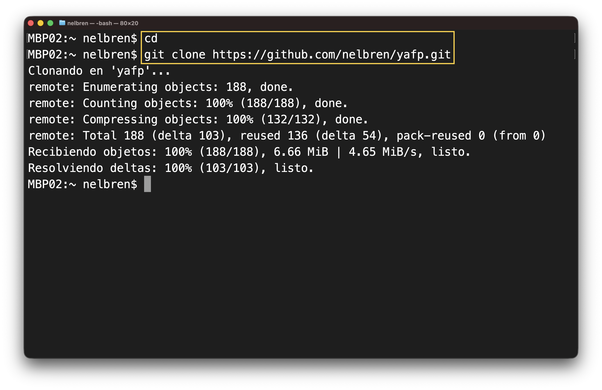

### 🌐︎ Global acquire

#### ⌨ Commands to acquire globally

```bash
sudo su -
cd /usr/local
git clone https://github.com/nelbren/yafp.git
```

#### 👁️ Example of acquire globally

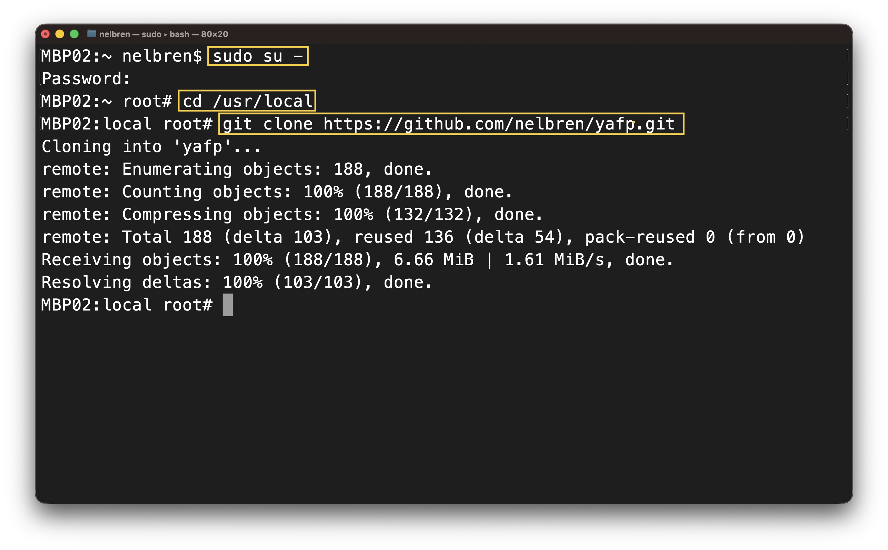

## II :gear: Configure

### 👤 Local Bash settings

#### ⌨ Commands to configure locally

```bash
cd ~/yafp
cp yafp-cfg.bash.example yafp-cfg.bash
```

#### 👁️ Example of local configuration

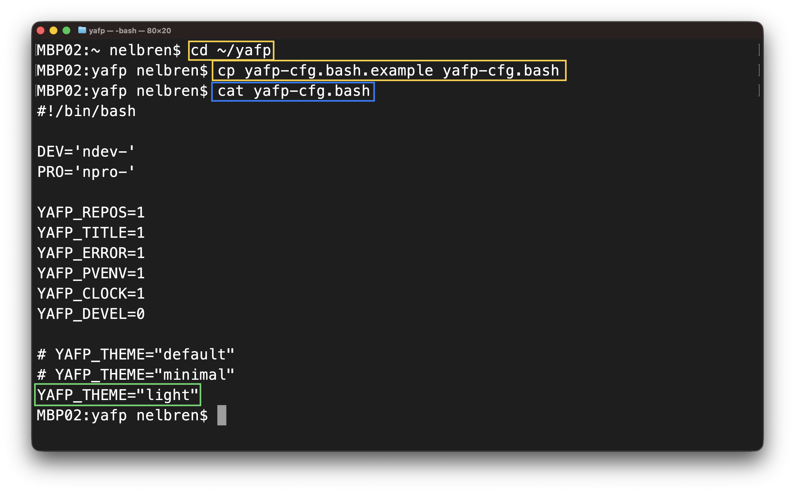

### 🪟 Local PowerShell settings

Create the personal configuration before loading the prompt:

```powershell
Copy-Item yafp-cfg.ps1.example yafp-cfg.ps1
```

Both `yafp-cfg.bash` and `yafp-cfg.ps1` are ignored by Git. Their `.example`
files define the versioned defaults and can be copied again when new options
are introduced.

### 🌐︎ Global settings

#### ⌨ Commands to configure globally

```bash
cd /usr/local/yafp
cp yafp-cfg.bash.example yafp-cfg.bash
```

#### 👁️ Example of global configuration

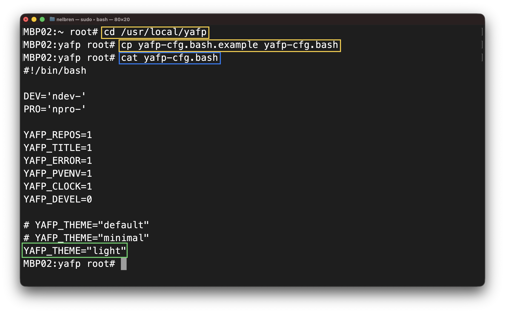

## III. :eyes: Preview

### 👤 Local preview

#### ⌨ Commands for local preview

```bash
source ~/yafp/yafp-ps1.bash
```

#### 👁️ Example of local preview

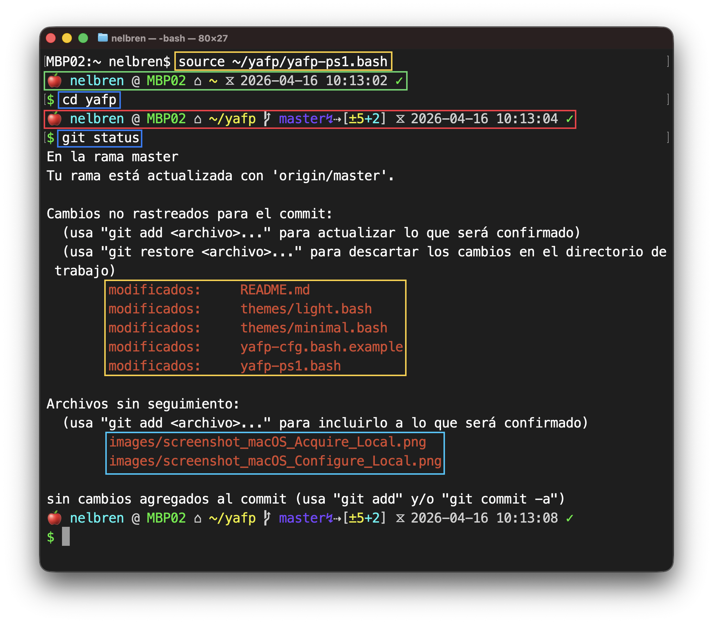

### 🌐︎ Global preview

#### ⌨ Commands for global preview

```bash
source /usr/local/yafp/yafp-ps1.bash
```

#### 👁️ Example of global preview

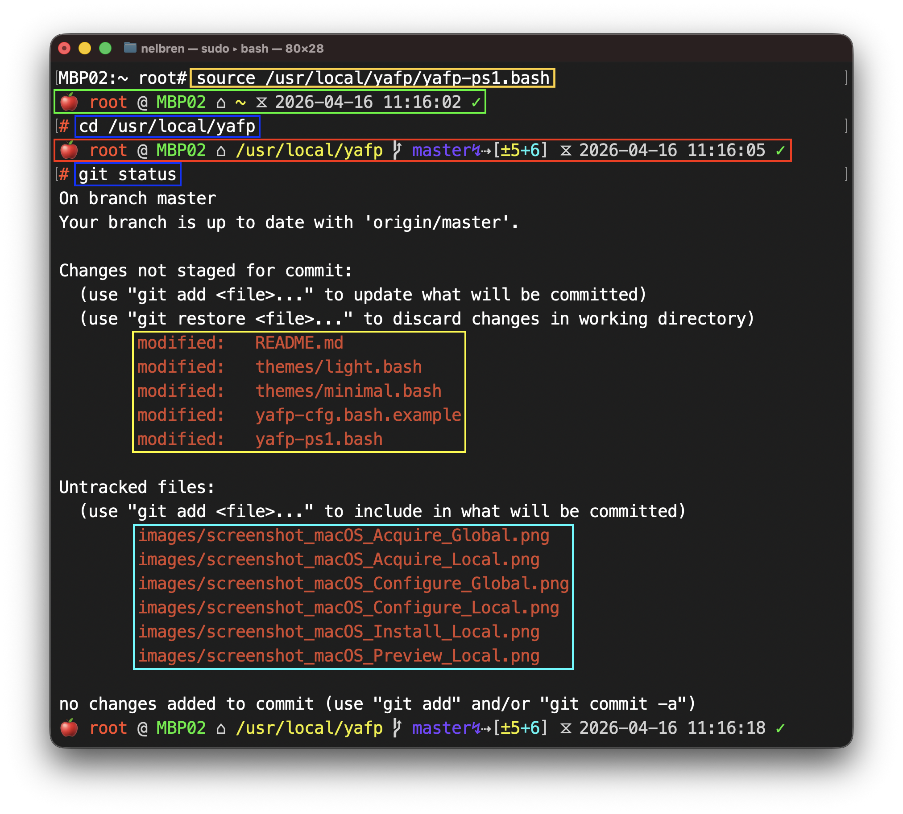

## IV. :heavy_check_mark: Install

### 👤 Local install

#### ⌨ Commands for local install

```bash
echo source ~/yafp/yafp-ps1.bash >> ~/.bash_profile 
```

#### 👁️ Example of local install

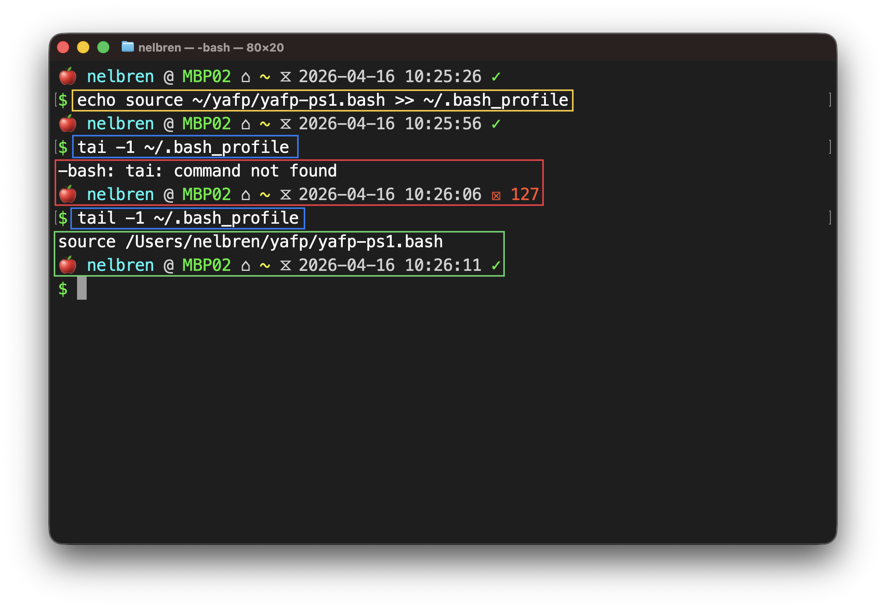

### 🌐︎ Global install

#### ⌨ Commands for global installation

```bash
echo source /usr/local/yafp/yafp-ps1.bash >> ~/.bash_profile 
```

#### 👁️ Example of global installation

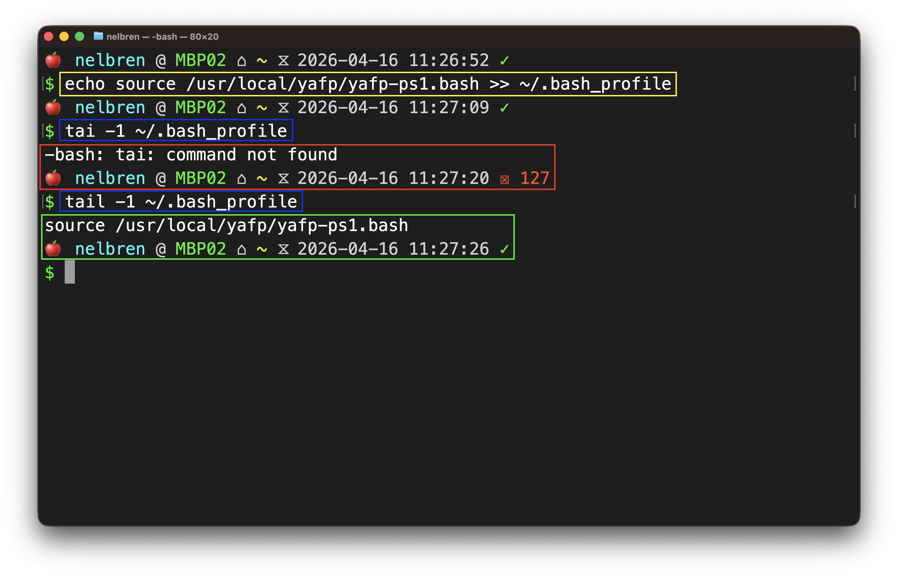

## V. Semantic command blocks with OSC 133

YAFP is a Bash/PowerShell prompt project. It does not own the pseudo-terminal,
ANSI parser, terminal renderer, or visible scrollback buffer. For terminals that
understand shell integration markers, both prompts emit OSC 133 sequences so
commands can be identified as semantic blocks:

```text
OSC 133 ; A  prompt start
OSC 133 ; B  prompt end / user input start
OSC 133 ; C  command start / output start
OSC 133 ; D  command finished, with exit code
```

For Windows Terminal and iTerm2 setup, including scrollbar marks and navigation
shortcuts, see [`OSC133.md`](docs/OSC133.md).

This is enabled by default in both configuration templates:

```bash
YAFP_OSC133=1
```

```powershell
$global:YAFP_OSC133 = 1
```

Set it to `0` if your terminal does not handle OSC 133 correctly:

```bash
YAFP_OSC133=0
```

```powershell
$global:YAFP_OSC133 = 0
```

YAFP preserves the visible prompt behavior when OSC 133 is disabled. When it is
enabled, OSC markers are wrapped as non-printing prompt sequences, so they should
not appear as visible text or disturb cursor positioning.

### Bash integration details

YAFP emits:

- `OSC 133;A` and `OSC 133;B` inside `PS1`;
- `OSC 133;C` from a Bash `DEBUG` trap when a user command starts;
- `OSC 133;D;<exit_code>` at the beginning of the next `PROMPT_COMMAND`.

Internally, the Bash implementation keeps a lightweight command-block model with
fields for id, command text, exit code, start time, finish time, duration, status,
and approximate history positions. The structure also reserves stdout/stderr
fields for a future terminal-side integration, but Bash alone cannot separate or
capture scrollback output without changing how commands are executed.

### PowerShell integration details

PowerShell follows the Windows Terminal integration model:

- `OSC 133;A` is emitted immediately before the visible prompt;
- `OSC 133;B` is returned immediately after the prompt mark;
- `OSC 133;D;<exit_code>` closes a command with its preserved status;
- `OSC 133;D` without an exit code represents empty input.

PowerShell has no shell-native pre-execution hook equivalent to Bash's `DEBUG`
trap, so YAFP does not replace PSReadLine key handlers merely to emit
`OSC 133;C`. Compatible terminals can use `autoMarkPrompts` with the A, B, and D
markers, following the documented Windows Terminal integration model.

### zsh and fish

The current implementation supports Bash and PowerShell. zsh and fish can use
the same OSC 133 protocol, but they need shell-native hooks such as
`precmd`/`preexec` in zsh or fish event handlers. A future YAFP shell module can
add those without inventing a new protocol.

### Current limitations

- YAFP cannot draw selectable visual borders around scrollback blocks because it
  is not the terminal renderer.
- stdout and stderr are not captured separately yet.
- buffer positions are approximate Bash history positions, not terminal cell
  coordinates.
- Advanced actions such as copy command, copy output, or copy whole block belong
  in a terminal UI layer or a future YAFP companion renderer.

### Tests

Install the complete local quality environment for Linux or macOS:

```bash
bash scripts/unix/setup/quality.bash
```

On Windows, install ShellCheck, PSScriptAnalyzer, and markdownlint with:

```powershell
pwsh -NoProfile -File scripts/windows/setup/quality.ps1
```

To install only PSScriptAnalyzer on Linux or macOS, with PowerShell 7.2.11 or
later (`pwsh`) already on `PATH`, run:

```bash
bash scripts/unix/setup/psscriptanalyzer.bash
```

On Windows, use the standalone PowerShell installer:

```powershell
pwsh -NoProfile -File scripts/windows/setup/psscriptanalyzer.ps1
```

Both entry points install PSScriptAnalyzer `1.25.0` from PSGallery for the
current user, reuse that version if it is already installed, and verify that
the module imports and exposes `Invoke-ScriptAnalyzer`. They do not require
administrator privileges or change the repository trust policy. Preview the
installation without downloading or importing modules with `--dry-run` on
Unix or `-DryRun` on Windows. PowerShell itself is a prerequisite and is not
installed by these scripts.

The Windows quality installer calls this same module installer. The Unix
quality installer continues to install ShellCheck and markdownlint; use the
standalone command above when PowerShell analysis is also needed. Installing
the analyzer on Unix does not enable tests that require Windows APIs.

The Windows setup prefers Scoop, then WinGet, then Chocolatey. ShellCheck is
included so the Bash validation can also run from Git Bash. Preview the
installation commands without changing the system with `--dry-run` on Unix or
`-DryRun` on Windows. Use `-PackageManager scoop`, `winget`, or `choco` to
override automatic selection.

<!-- markdownlint-disable MD013 -->

| Platform | Package managers                            | Installed tools                            |
| -------- | ------------------------------------------- | ------------------------------------------ |
| Linux    | APT, DNF, Pacman, or Zypper                 | ShellCheck and markdownlint                |
| macOS    | Homebrew                                    | ShellCheck and markdownlint                |
| Windows  | Scoop, WinGet, or Chocolatey; PowerShellGet | ShellCheck, PSScriptAnalyzer, markdownlint |

<!-- markdownlint-enable MD013 -->

Git Bash delegates environment installation to the Windows setup script. The
quality runners verify each setup plan before running their platform tests.

Diagnose missing commands, personal configuration, invalid option values,
theme pairs, and shell profile integration without changing the system:

```bash
bash scripts/unix/doctor/check.bash
```

```powershell
pwsh -NoProfile -File scripts/windows/doctor/check.ps1
```

Use `--strict` on Unix or `-Strict` on Windows when warnings such as missing
optional linters should also produce a failing exit code. For an alternate
configuration file, use `--config PATH` or `-ConfigPath PATH`.

The Unix doctor's summary displays passed checks in intense green, warnings
in intense yellow, and errors in intense red, including zero counts. It uses
plain text when output is redirected or `NO_COLOR` is set to a non-empty value.

Run all Bash tests, syntax checks, and installed linters with:

```bash
bash scripts/unix/quality/check.bash
```

Run all PowerShell tests, parser checks, and installed linters with:

```powershell
pwsh -NoProfile -File scripts/windows/quality/check.ps1
```

The quality scripts use `shellcheck`, PSScriptAnalyzer, and `markdownlint` when
they are available. Set `YAFP_REQUIRE_LINTERS=1` to make a missing analyzer an
error, as continuous integration does. Successful lines use a green `✅`,
warnings use a yellow `⚠️`, and failures use a red `❌`; all retain their
textual meaning when color is unavailable.

Resource collector tests use one `vm_stat` stub with success and failure modes.
This avoids redefining the function, which can trigger an unreachable-code
diagnostic in ShellCheck even though the collector invokes both test cases.
The unreachable-code checks remain enabled.

On Windows, run the Bash checks from a complete Git Bash session. When invoking
Bash through a PowerShell shim, use login mode so Unix tools are on `PATH`:

```bash
bash -lc 'cd /c/path/to/yafp && bash scripts/unix/quality/check.bash'
```

GitHub Actions runs the same checks on Linux, macOS, and Windows. See
[`docs/ARCHITECTURE.md`](docs/ARCHITECTURE.md) for component boundaries,
runtime invariants, and the safe modularization strategy.

### Origin device commit trailer

Install the versioned `prepare-commit-msg` hook for the current repository:

```bash
bash scripts/unix/git/setup.bash
```

Preview the target without changing the repository with `--dry-run`. Use
`--repo PATH` to install it in another checkout. The hook obtains the macOS
Computer Name first, then falls back to `COMPUTERNAME` on Windows or the short
hostname on other Unix systems. It adds an `Origin-Device` trailer only when
one is not already present. The installer is idempotent and refuses to
overwrite a different existing `prepare-commit-msg` hook.

---

## YAFP startup tracking

YAFP records one activation per interactive shell process after the prompt
loads successfully. Reloading in the same session does not record another
activation. Each new terminal or SSH session has its own activation. Internal
function calls and prompt redraws are not recorded.

A background writer runs once using the existing ai-dev-tools Python runtime.
It uses `AI_DEV_TOOLS_ROOT` or `~/ai-dev-tools` and stores an `application`
event with source `yafp/startup/bash`, `yafp/startup/zsh`, or
`yafp/startup/powershell`. It starts no services and makes no network requests.
The shared SQLite database stays outside the checkout at
`PROJECT_TEST_HOME/repository-metrics/IDENTITY/executions.sqlite3`, or in the
default local ai-dev-tools store.

The counter appears in the application executions section of Software Facts
for the YAFP checkout. It does not measure commands, redraws, duration, or
sessions from before this integration. The `yafp-stats` command counters retain
their separate per-session scope.

If a prepared ai-dev-tools runtime is unavailable, the prompt keeps working and
Software Facts retains the missing measurement. Writer errors are recorded in
`PROJECT_TEST_HOME/application-startup-errors.log`. To disable the counter, set
`YAFP_METRICS_DISABLED=1` before loading YAFP; in PowerShell, use
`$env:YAFP_METRICS_DISABLED = '1'`. Quality runners disable real tracking; their
contract tests use temporary environments and writers.

Prompt functions must not be instrumented as another project's aliases merely
because they share a prefix. After updating ai-dev-tools and YAFP, a session
with earlier instrumentation can clear it and reload the prompt with:

```bash
AIDT_alias-reload; yafp-reload
```

New shells apply the integration when YAFP loads. Git-ignored personal
configurations do not need changes.

## Classified test records

`.project-test.yml` declares the existing suites by platform. On Unix,
`scripts/unix/quality/project-test.sh` runs the Bash tests and zsh checks
without mixing static analysis with test counts. PowerShell suites retain
their Windows selection.

```sh
project-test run --path . --profile quick
software-facts --path .
```

The shell runner preserves logs and aggregate status. Internal case counts
remain uncollected when no native report is provided; this does not mean zero.
Full quality validation still uses the entry points in the existing testing
section and does not install analyzers during a run.

<!-- markdownlint-disable MD033 -->
<div style="text-align: right; font-size: 12px;">
📆 2026-10-30 20:19:47  MBP02 |
֎ OpenAI 🤖 Codex 🧠 GPT-6 No expuesto & 👨🏻‍💻 Nelbren ©️ 2026
</div>
