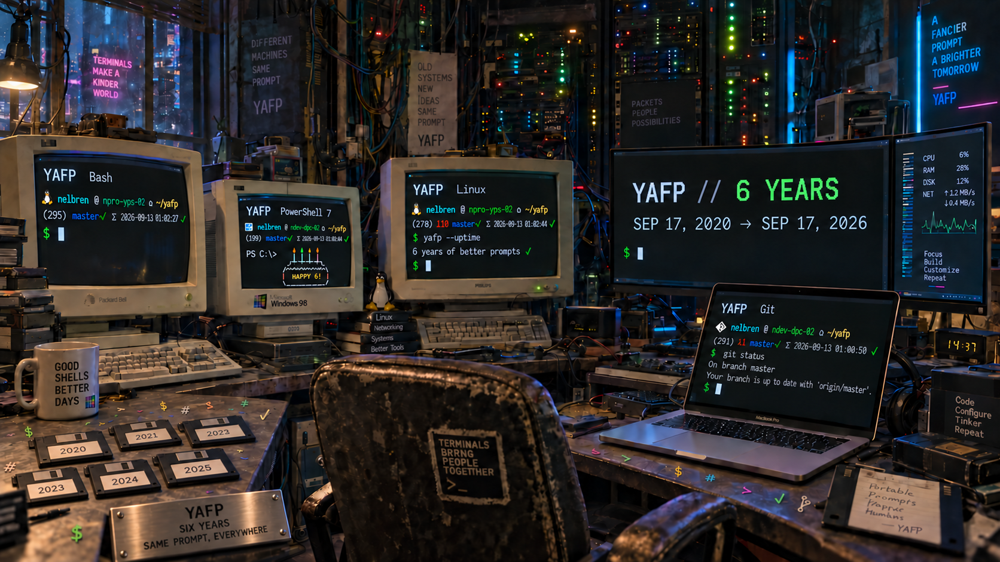

# :computer: Yet Another Fancy Prompt 🖥️

[![made-with-bash][badge-bash]][bash]
[![made-with-zsh][badge-zsh]][zsh]
[![made-with-powershell][badge-powershell]][powershell]
![version][badge-version]
![themes][badge-themes]

[badge-bash]: https://img.shields.io/badge/Made%20with-Bash-1f425f.svg
[badge-zsh]: https://img.shields.io/badge/Made%20with-Zsh-1f425f
[zsh]: https://zsh.sourceforge.io/
[badge-powershell]: https://img.shields.io/badge/Made%20with-PowerShell-5391FE.svg?logo=powershell
[badge-version]: https://img.shields.io/badge/version-0.5.0-green
[badge-themes]: https://img.shields.io/badge/themes-8A2BE2?logo=educative
[bash]: https://www.gnu.org/software/bash/
[powershell]: https://docs.microsoft.com/powershell/

YAFP is a customizable terminal prompt for Bash, zsh 5.9+ and PowerShell 7.
It shows the working directory, Git changes and the last command’s exit status.
Optional indicators add machine resources and the time until your Codex quota
resets. Use a [Nerd Font][fonts] to display the icons.

Use Bash on Linux, macOS, WSL2 or Git Bash, zsh on Linux or macOS, and
PowerShell 7 on Windows.

## Anatomy of a YAFP prompt

![Annotated light prompt with six arrows pointing to its indicators][anatomy]

Read the example from left to right:

| Prompt segment | What it tells you |
| --- | --- |
| `֍⣶3d4h` | The Braille cell shows the quota level. It resets in 3d 4h. |
| `⣀▦⣶⡀⣷` | CPU, RAM, swap and disk use, in that order. |
| ` ~demo/yafp` | The working directory inside the demo repository. |
| `main↦[1]` | The current branch is `main`. One tracked file has edits. |
| ` 2` | The last command returned exit code 2. |

## Quick start

Clone YAFP in your home directory for a local installation:

```sh
cd ~
git clone https://github.com/nelbren/yafp.git
cd yafp
```

Load it in the shell you use. These commands keep existing personal settings.

### Bash

```bash
[ -f yafp-cfg.bash ] || cp yafp-cfg.bash.example yafp-cfg.bash
source ./yafp-ps1.bash
```

### zsh

```zsh
[ -f yafp-cfg.zsh ] || cp yafp-cfg.zsh.example yafp-cfg.zsh
source ./yafp-ps1.zsh
```

### PowerShell 7

```powershell
if (!(Test-Path ./yafp-cfg.ps1)) {
    Copy-Item ./yafp-cfg.ps1.example ./yafp-cfg.ps1
}
. ./yafp-ps.ps1
```

Run `yafp-help` to verify the installation and see the available commands.
To load YAFP in future sessions, follow the [installation guide][install].

## Gallery

![Default, minimal and light rendering the same Git and shell state][comparison]

The three themes show the same branch, modified file and exit code.
[Watch the prompt respond to commands (MP4, 25 seconds)][prompt-video] to
see how a tracked edit, a failed command and a successful restore appear.
The demo uses a temporary Git repository and fixed clock and resource samples.

### Terminal screen

![Tron light cycles on the resource and quota screen][tron-preview]

Run `yafp-screen-themes` to list the eight backgrounds and the `random`
and `off` modes. [Watch the background tour (MP4, 48 seconds)][background-tour]
or open the [screen guide][screen] to try a scene. **B** toggles the
background name and **Q** exits.

[anatomy]: docs/images/yafp-prompt-anatomy.png
[comparison]: docs/images/yafp-prompt-themes.png
[prompt-video]: docs/images/yafp-prompt-in-action.mp4

[tron-preview]: docs/images/yafp-screen-tron.gif
[background-tour]: docs/images/yafp-screen-backgrounds.mp4

## Guides

| Task | Guide |
| --- | --- |
| Install, configure, update or reload YAFP | [Installation][install] |
| Choose a theme and read the prompt | [Prompt themes and commands][prompt] |
| Configure machine resources and Codex quota | [Monitoring][monitoring] |
| Inspect changes, remote status and alerts | [Git][git-guide] |
| Run the animated display and choose a background | [Terminal screen][screen] |
| Choose a terminal font or identify a glyph | [Fonts and icons][fonts] |
| Navigate command output in supported terminals | [OSC 133][osc] |
| Run tests, inspect timing and work on YAFP | [Development][dev] |
| Understand how the shell engines work | [Architecture][arch] |

[install]: docs/INSTALLATION.md
[prompt]: docs/PROMPT.md
[monitoring]: docs/MONITORING.md
[git-guide]: docs/GIT.md
[screen]: docs/SCREEN.md
[fonts]: docs/FONTS.md
[osc]: docs/OSC133.md
[dev]: docs/DEVELOPMENT.md
[arch]: docs/ARCHITECTURE.md



<!-- markdownlint-disable MD033 -->
<div style="text-align: right; font-size: 12px;">
📆 2026-11-26 00:16:28 🍎 No expuesto |
֎ OpenAI 🤖 Codex 🧠 GPT-6.2 Sol No expuesto & 👨🏻‍💻 Nelbren ©️ 2026
</div>
