# Fonts with consistent Unicode fallback

## Preview sample

The current preview sample uses these two lines.

<!-- markdownlint-disable MD013 -->
```less
🪟 nelbren↤[֍⣿4d21h] @ NDEV-DPC-02↦[⚙⣄▦⣀⇄⡀◉⣿~] ⌂ ~\yafp ↦[⣦✓🌐︎] master↯↦[±1+1] ⧖ 2026-10-30 09:03:27 ✓
$
```
<!-- markdownlint-enable MD013 -->

1. ### [Ioskeley Mono][preview-ioskeley]

   #### ④ Logos — Ioskeley Mono

   |OS|macOS|Windows|Debian|Kali|
   |:--:|:--:|:--:|:--:|:--|
   |4/4|✓|✓|✓|✓|

   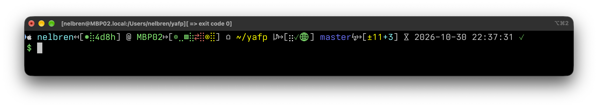

2. ### [Cozette][preview-cozette]

   #### ④ Logos — Cozette

   |OS|macOS|Windows|Debian|Kali|
   |:--:|:--:|:--:|:--:|:--|
   |4/4|✓|✓|✓|✓|

   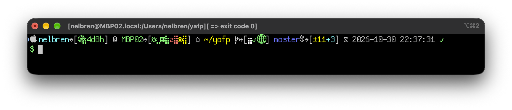

3. ### [Aporetic Sans Mono][preview-aporetic-sans]

   #### ¾ Logos — Aporetic Sans Mono

   |OS|macOS|Windows|Debian|Kali|
   |:--:|:--:|:--:|:--:|:--|
   |==3/4==|✓|✓|==✗==|✓|

   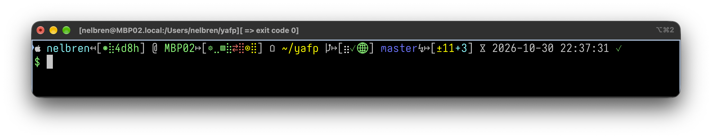

4. ### [psudoFont Liga Mono][preview-psudo]

   #### ¾ Logos — psudoFont Liga Mono

   |OS|macOS|Windows|Debian|Kali|
   |:--:|:--:|:--:|:--:|:--|
   |==3/4==|✓|✓|==✗==|✓|

   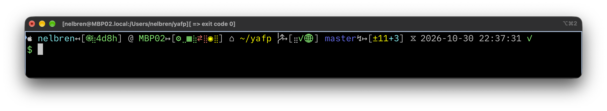

5. ### [Adwaita Mono][preview-adwaita-mono]

   #### ¾ Logos — Adwaita Mono

   |OS|macOS|Windows|Debian|Kali|
   |:--:|:--:|:--:|:--:|:--|
   |==3/4==|✓|✓|==✗==|✓|

   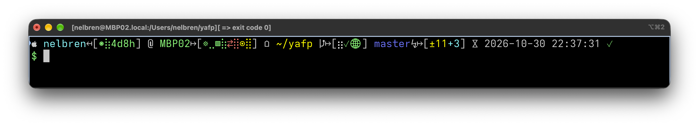

6. ### [Monofoki][preview-monofoki]

   #### ¾ Logos — Monofoki

   |OS|macOS|Windows|Debian|Kali|
   |:--:|:--:|:--:|:--:|:--|
   |==3/4==|✓|✓|==✗==|✓|

   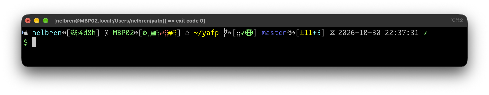

7. ### [JuliaMono][preview-julia-mono]

   #### ¾ Logos — JuliaMono

   |OS|macOS|Windows|Debian|Kali|
   |:--:|:--:|:--:|:--:|:--|
   |==3/4==|✓|✓|==✗==|✓|

   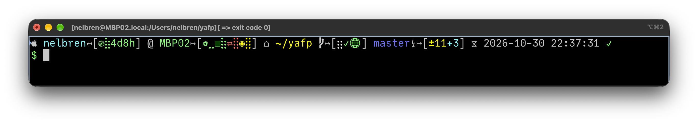

8. ### [JetBrains Mono][preview-jetbrainsmono]

   #### ¾ Logos — JetBrains Mono

   |OS|macOS|Windows|Debian|Kali|
   |:--:|:--:|:--:|:--:|:--|
   |==3/4==|✓|✓|==✗==|✓|

   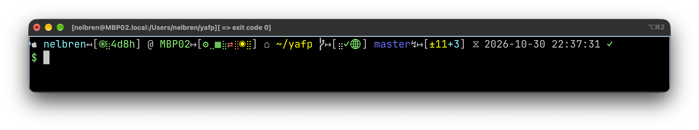

9. ### [Lilex][preview-lilex]

   #### ¾ Logos — Lilex

   |OS|macOS|Windows|Debian|Kali|
   |:--:|:--:|:--:|:--:|:--|
   |==3/4==|✓|✓|==✗==|✓|

   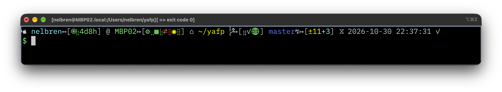

10. ### [Victor Mono][preview-victor-mono]

    #### ¾ Logos — Victor Mono

    |OS|macOS|Windows|Debian|Kali|
    |:--:|:--:|:--:|:--:|:--|
    |==3/4==|✓|✓|==✗==|✓|

    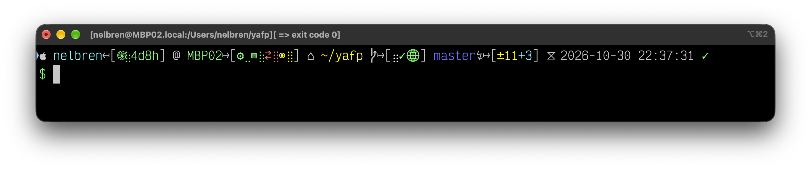

11. ### [Proggy Vector][preview-proggy-vector]

    #### ¾ Logos — Proggy Vector

    |OS|macOS|Windows|Debian|Kali|
    |:--:|:--:|:--:|:--:|:--|
    |==3/4==|✓|✓|==✗==|✓|

    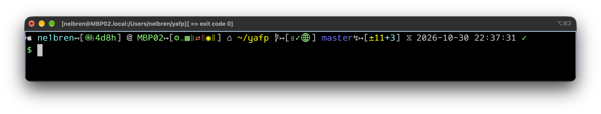

12. ### [Spleen][preview-spleen]

    #### ¾ Logos — Spleen

    |OS|macOS|Windows|Debian|Kali|
    |:--:|:--:|:--:|:--:|:--|
    |==3/4==|✓|✓|==✗==|✓|

    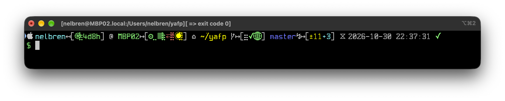

13. ### [D2Coding][preview-d2coding]

    #### ¾ Logos — D2Coding

    |OS|macOS|Windows|Debian|Kali|
    |:--:|:--:|:--:|:--:|:--|
    |==3/4==|✓|✓|==✗==|✓|

    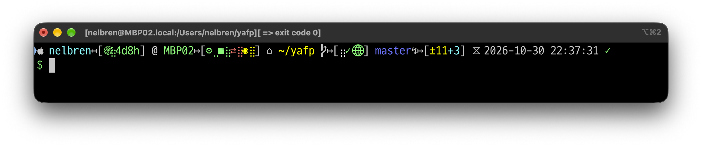

14. ### [Bront DejaVu Sans Mono][preview-bront-dejavu]

    #### ¾ Logos — Bront DejaVu Sans Mono

    |OS|macOS|Windows|Debian|Kali|
    |:--:|:--:|:--:|:--:|:--|
    |==3/4==|✓|✓|==✗==|✓|

    

15. ### [Bront Ubuntu Mono][preview-bront-ubuntu]

    #### ¾ Logos — Bront Ubuntu Mono

    |OS|macOS|Windows|Debian|Kali|
    |:--:|:--:|:--:|:--:|:--|
    |==3/4==|✓|✓|==✗==|✓|

    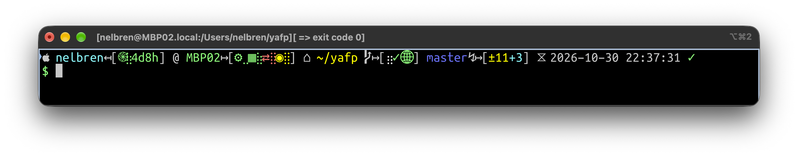

16. ### [IBM 3270][preview-font3270]

    #### ¾ Logos — IBM 3270

    |OS|macOS|Windows|Debian|Kali|
    |:--:|:--:|:--:|:--:|:--|
    |==3/4==|✓|✓|==✗==|✓|

    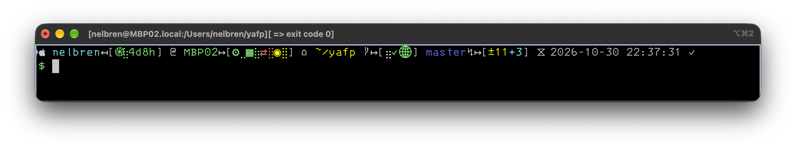

17. ### [Monoid][preview-monoid]

    #### ¾ Logos — Monoid

    |OS|macOS|Windows|Debian|Kali|
    |:--:|:--:|:--:|:--:|:--|
    |==3/4==|✓|✓|==✗==|✓|

    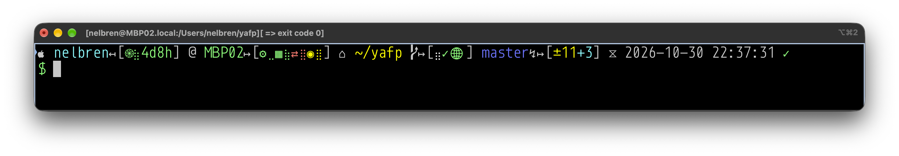

18. ### [Iosevka][preview-iosevka]

    #### ¾ Logos — Iosevka

    |OS|macOS|Windows|Debian|Kali|
    |:--:|:--:|:--:|:--:|:--|
    |==3/4==|✓|✓|==✗==|✓|

    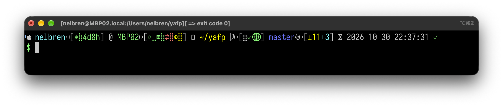

19. ### [Hack][preview-hack]

    #### ¾ Logos — Hack

    |OS|macOS|Windows|Debian|Kali|
    |:--:|:--:|:--:|:--:|:--|
    |==3/4==|✓|✓|==✗==|✓|

    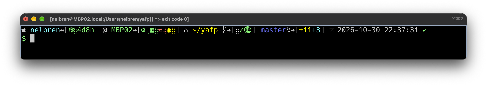

20. ### [Hack Ligatured][preview-hack-ligatured]

    #### ¾ Logos — Hack Ligatured

    |OS|macOS|Windows|Debian|Kali|
    |:--:|:--:|:--:|:--:|:--|
    |==3/4==|==✗==|✓|✓|✓|

    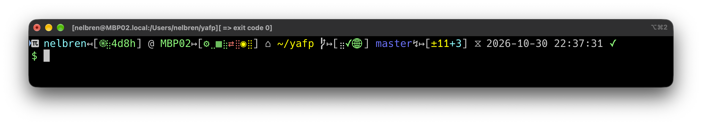

21. ### [Office Code Pro][preview-office-code-pro]

    #### ¾ Logos — Office Code Pro

    |OS|macOS|Windows|Debian|Kali|
    |:--:|:--:|:--:|:--:|:--|
    |==3/4==|✓|✓|==✗==|✓|

    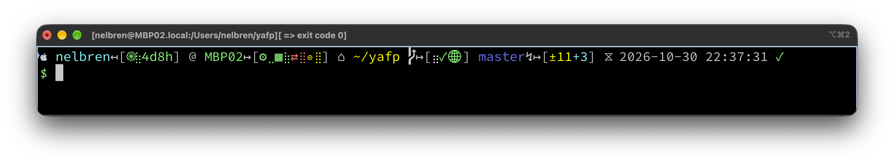

22. ### [Fira Code][preview-firacode]

    #### ¾ Logos — Fira Code

    |OS|macOS|Windows|Debian|Kali|
    |:--:|:--:|:--:|:--:|:--|
    |==3/4==|✓|✓|==✗==|✓|

    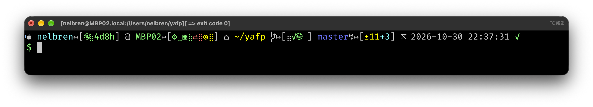

23. ### [Hasklig][preview-hasklig]

    #### ¾ Logos — Hasklig

    |OS|macOS|Windows|Debian|Kali|
    |:--:|:--:|:--:|:--:|:--|
    |==3/4==|✓|✓|==✗==|✓|

    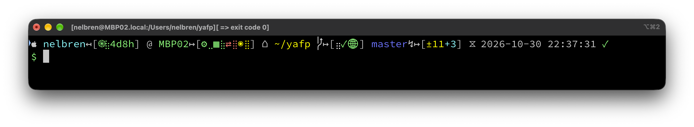

24. ### [mononoki][preview-mononoki]

    #### ¾ Logos — mononoki

    |OS|macOS|Windows|Debian|Kali|
    |:--:|:--:|:--:|:--:|:--|
    |==3/4==|✓|✓|==✗==|✓|

    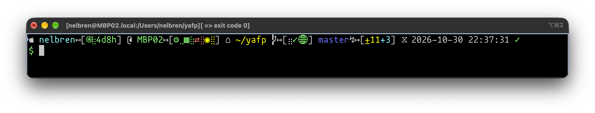

25. ### [Fantasque Sans Mono][preview-fantasque-sans]

    #### ¾ Logos — Fantasque Sans Mono

    |OS|macOS|Windows|Debian|Kali|
    |:--:|:--:|:--:|:--:|:--|
    |==3/4==|✓|✓|==✗==|✓|

    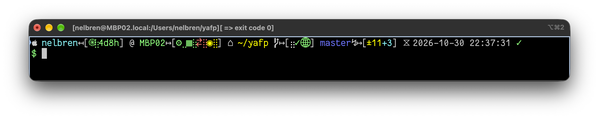

26. ### [Hermit][preview-hermit]

    #### ¾ Logos — Hermit

    |OS|macOS|Windows|Debian|Kali|
    |:--:|:--:|:--:|:--:|:--|
    |==3/4==|✓|✓|==✗==|✓|

    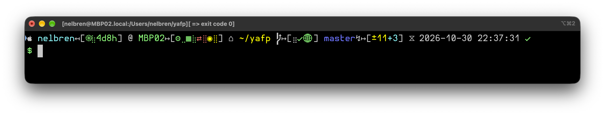

27. ### [Source Code Pro][preview-source-code-pro]

    #### ¾ Logos — Source Code Pro

    |OS|macOS|Windows|Debian|Kali|
    |:--:|:--:|:--:|:--:|:--|
    |==3/4==|✓|✓|==✗==|✓|

    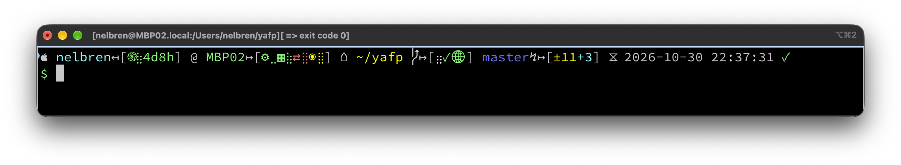

28. ### [Sudo][preview-sudo]

    #### ¾ Logos — Sudo

    |OS|macOS|Windows|Debian|Kali|
    |:--:|:--:|:--:|:--:|:--|
    |==3/4==|✓|✓|==✗==|✓|

    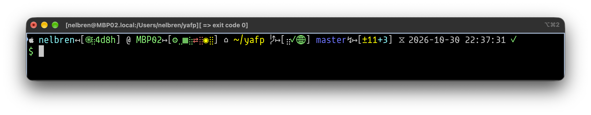

29. ### [Luculent][preview-luculent]

    #### ¾ Logos — Luculent

    |OS|macOS|Windows|Debian|Kali|
    |:--:|:--:|:--:|:--:|:--|
    |==3/4==|✓|✓|==✗==|✓|

    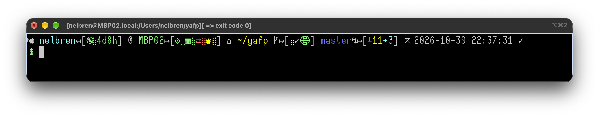

[preview-aporetic-sans]: https://www.programmingfonts.org/#aporetic-sans
[preview-psudo]: https://www.programmingfonts.org/#psudo
[preview-ioskeley]: https://www.programmingfonts.org/#ioskeley
[preview-adwaita-mono]: https://www.programmingfonts.org/#adwaita-mono
[preview-monofoki]: https://www.programmingfonts.org/#monofoki
[preview-julia-mono]: https://www.programmingfonts.org/#julia-mono
[preview-cozette]: https://www.programmingfonts.org/#cozette
[preview-jetbrainsmono]: https://www.programmingfonts.org/#jetbrainsmono
[preview-lilex]: https://www.programmingfonts.org/#lilex
[preview-victor-mono]: https://www.programmingfonts.org/#victor-mono
[preview-proggy-vector]: https://www.programmingfonts.org/#proggy-vector
[preview-spleen]: https://www.programmingfonts.org/#spleen
[preview-d2coding]: https://www.programmingfonts.org/#d2coding
[preview-bront-dejavu]: https://www.programmingfonts.org/#bront-dejavu
[preview-bront-ubuntu]: https://www.programmingfonts.org/#bront-ubuntu
[preview-font3270]: https://www.programmingfonts.org/#font3270
[preview-monoid]: https://www.programmingfonts.org/#monoid
[preview-iosevka]: https://www.programmingfonts.org/#iosevka
[preview-hack]: https://www.programmingfonts.org/#hack
[preview-hack-ligatured]: https://www.programmingfonts.org/#hack-ligatured
[preview-office-code-pro]: https://www.programmingfonts.org/#office-code-pro
[preview-firacode]: https://www.programmingfonts.org/#firacode
[preview-hasklig]: https://www.programmingfonts.org/#hasklig
[preview-mononoki]: https://www.programmingfonts.org/#mononoki
[preview-fantasque-sans]: https://www.programmingfonts.org/#fantasque-sans
[preview-hermit]: https://www.programmingfonts.org/#hermit
[preview-source-code-pro]: https://www.programmingfonts.org/#source-code-pro
[preview-sudo]: https://www.programmingfonts.org/#sudo
[preview-luculent]: https://www.programmingfonts.org/#luculent

<!-- markdownlint-disable MD033 -->
<div style="text-align: right; font-size: 12px;">
📆 2026-10-30 23:49:24  MBP02 |
֎ OpenAI 🤖 Codex 🧠 GPT-6.1 Sol High & 👨🏻‍💻 Nelbren ©️ 2026
</div>
