# Fonts with consistent Unicode fallback

## Prompt icons

Static labels use Font Awesome through Nerd Fonts in Bash, zsh, and
PowerShell. The local terminal must use a Nerd Font containing these code
points, including when displaying an SSH session. Python and `user-shield`
use Nerd Fonts remapped code points rather than the original Font Awesome
code points.

| No. | Use                             | Icon        | Nerd Fonts code      |
| --- | ------------------------------- | ----------- | -------------------- |
| 1   | Warning                         | ``         | `F071`               |
| 2   | Error                           | ``         | `F057`               |
| 3   | Success                         | ``         | `F058`               |
| 4   | Git: deleted                    | ``         | `F1F8`               |
| 5   | Git: modified                   | ``         | `F044`               |
| 6   | Git: new                        | ``         | `F0FE`               |
| 7   | Git: staged for commit          | ``         | `F187`               |
| 8   | Python                          | ``         | `ED1B`               |
| 9   | User                            | ``         | `F007`               |
| 10  | Administrator                   | ``         | `EDCF`               |
| 11  | Local computer / SSH client     | ` / `     | `F108 / F109`        |
| 12  | Local location in minimal       | ``         | `F015`               |
| 13  | Previous command in default     | ``         | `F120`               |
| 14  | Remote / timer                  | ``         | `F0E7`               |
| 15  | Performance: fast/medium/slow   | ` /  / ` | `F135 / F2F2 / F252` |
| 16  | General debugging context       | ``         | `F013`               |
| 17  | Git debugging context           | ``         | `F1D3`               |
| 18  | Urgency of the next check       | ``         | `F111`               |

The catalog lists the approved replacements; each theme keeps the labels it
already displayed. For example, the Bash/zsh `default` environment keeps its
name in brackets, and `light` keeps `↯` and its numeric counters. Success and
error markers use `` and `` throughout YAFP's prompt, banners, message
catalog, statistics, and startup update messages, including `light`. The timer
circle keeps its green, yellow, and red colors alongside the percentage and
seconds. Thresholds and logic remain unchanged.

The compact remote failure icon `` (`U+F072`) uses intense white text on an
intense red background while the `(  REMOTE CHECK FAILED )` alert is active,
independently of `YAFP_DARKC`. After `yafp-ack`, the banner is hidden and the
icon uses intense red text on a transparent background.

Braille indicators, `֍`, `` for background refresh, `⟳` for initial pending
data, frames, and time-of-day symbols retain their representation. Replacements
affect YAFP's decoration; emoji in commands, paths, branches, or environment
names remain intact. Installation, doctor, and quality tools keep their text
symbols.

`yafp-status` and `yafp-demo` use `` (`U+F0AC`) for the remote, ``
(`U+F058`) for up-to-date status, `` (`U+F017`) for the current time, and ``
(`U+F274`) for the next check. Report labels stay aligned and preserve their
colors and `unavailable` output. The preview is introduced by `` (`U+F120`);
the `Ctrl+C` reminder uses `` (`U+EDFE`, infinity remapped by Nerd Fonts) and
`` (`U+F021`, refresh). The loop interval remains four seconds.

The `yafp-codex` frame uses `` (`U+F274`) for the reset, `` (`U+F21E`,
heartbeat) for the state, and `` (`U+F200`, chart-pie) for the remaining quota.
States use `` (`U+F058`) for `ok`, `` (`U+F252`) for `pending`, ``
(`U+F204`) for `disabled`, `` (`U+F023`) for `logged-out`, `` (`U+F05E`)
for `unsupported-auth`, `` (`U+F071`) for missing dependencies, ``
(`U+F017`) for `timeout`, and `` (`U+F057`) for `unavailable`. Unavailable
`Reset` and `Remaining` values use a gray `` (`U+F059`, question-circle).
State names accompany the icons even without color.

The `yafp-resources` report adds `` (`U+EFC5`, memory remapped by Nerd Fonts)
for RAM. CPU uses `` (`U+F2DB`), SWAP uses `` (`U+F0EC`), and disk uses
`` (`U+F0A0`). State reuses `` (`U+F21E`), sample age uses ``
(`U+F017`), and missing values use a gray `` (`U+F059`). The refresh icon
`` and cached data retain their monitoring semantics.

References: [Font Awesome][font-awesome] and the [Nerd Fonts catalog][nerd-glyphs].

[font-awesome]: https://github.com/FortAwesome/Font-Awesome/blob/6.7.2/css/all.css
[nerd-glyphs]: https://github.com/ryanoasis/nerd-fonts/blob/master/glyphnames.json

## Preview sample

The following screenshots preserve this historical sample, which predates the
icon replacements in the current catalog.

<!-- markdownlint-disable MD013 -->
```less
🪟 nelbren↤[֍⣿4d21h] @ NDEV-DPC-02↦[⚙⣄▦⣀⇄⡀◉⣿] ⌂ ~\yafp ↦[⣦✓🌐︎] master↯↦[±1+1] ⧖ 2026-10-30 09:03:27 ✓
$
```
<!-- markdownlint-enable MD013 -->

1. ### [Ioskeley Mono][preview-ioskeley]

   #### ④ Logos — Ioskeley Mono

   |OS|macOS|Windows|Debian|Kali|
   |:--:|:--:|:--:|:--:|:--|
   |4/4|✓|✓|✓|✓|

   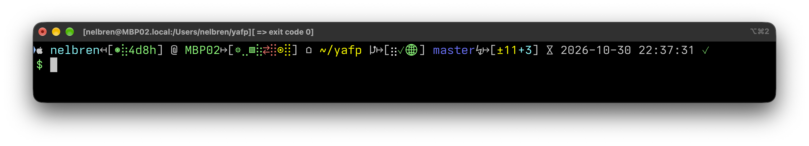

2. ### [Cozette][preview-cozette]

   #### ④ Logos — Cozette

   |OS|macOS|Windows|Debian|Kali|
   |:--:|:--:|:--:|:--:|:--|
   |4/4|✓|✓|✓|✓|

   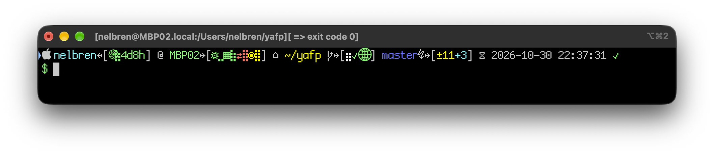

3. ### [Aporetic Sans Mono][preview-aporetic-sans]

   #### ¾ Logos — Aporetic Sans Mono

   |OS|macOS|Windows|Debian|Kali|
   |:--:|:--:|:--:|:--:|:--|
   |==3/4==|✓|✓|==✗==|✓|

   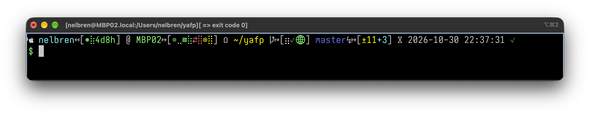

4. ### [psudoFont Liga Mono][preview-psudo]

   #### ¾ Logos — psudoFont Liga Mono

   |OS|macOS|Windows|Debian|Kali|
   |:--:|:--:|:--:|:--:|:--|
   |==3/4==|✓|✓|==✗==|✓|

   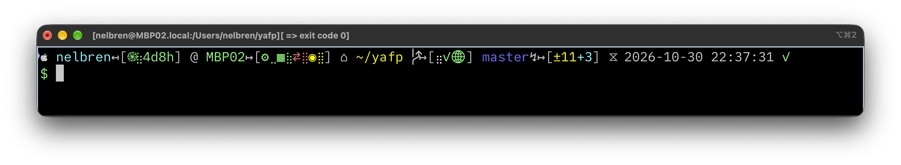

5. ### [Adwaita Mono][preview-adwaita-mono]

   #### ¾ Logos — Adwaita Mono

   |OS|macOS|Windows|Debian|Kali|
   |:--:|:--:|:--:|:--:|:--|
   |==3/4==|✓|✓|==✗==|✓|

   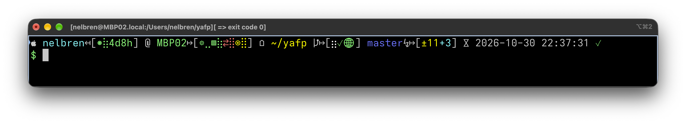

6. ### [Monofoki][preview-monofoki]

   #### ¾ Logos — Monofoki

   |OS|macOS|Windows|Debian|Kali|
   |:--:|:--:|:--:|:--:|:--|
   |==3/4==|✓|✓|==✗==|✓|

   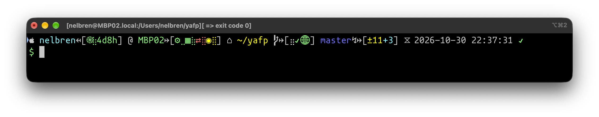

7. ### [JuliaMono][preview-julia-mono]

   #### ¾ Logos — JuliaMono

   |OS|macOS|Windows|Debian|Kali|
   |:--:|:--:|:--:|:--:|:--|
   |==3/4==|✓|✓|==✗==|✓|

   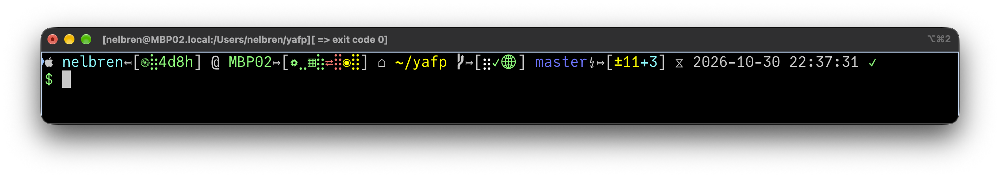

8. ### [JetBrains Mono][preview-jetbrainsmono]

   #### ¾ Logos — JetBrains Mono

   |OS|macOS|Windows|Debian|Kali|
   |:--:|:--:|:--:|:--:|:--|
   |==3/4==|✓|✓|==✗==|✓|

   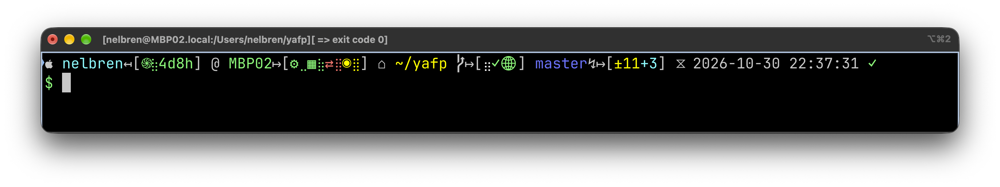

9. ### [Lilex][preview-lilex]

   #### ¾ Logos — Lilex

   |OS|macOS|Windows|Debian|Kali|
   |:--:|:--:|:--:|:--:|:--|
   |==3/4==|✓|✓|==✗==|✓|

   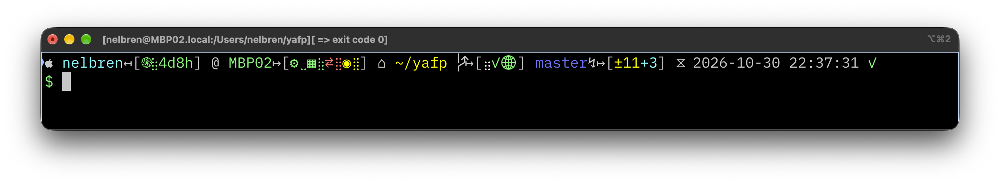

10. ### [Victor Mono][preview-victor-mono]

    #### ¾ Logos — Victor Mono

    |OS|macOS|Windows|Debian|Kali|
    |:--:|:--:|:--:|:--:|:--|
    |==3/4==|✓|✓|==✗==|✓|

    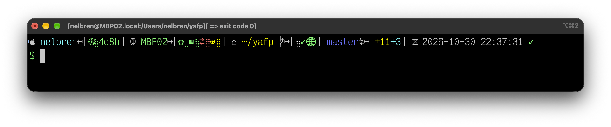

11. ### [Proggy Vector][preview-proggy-vector]

    #### ¾ Logos — Proggy Vector

    |OS|macOS|Windows|Debian|Kali|
    |:--:|:--:|:--:|:--:|:--|
    |==3/4==|✓|✓|==✗==|✓|

    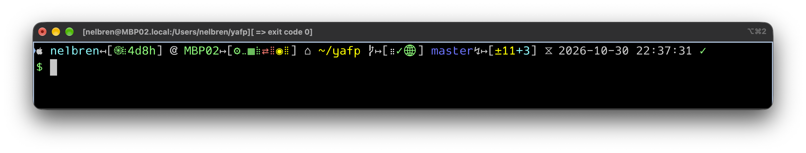

12. ### [Spleen][preview-spleen]

    #### ¾ Logos — Spleen

    |OS|macOS|Windows|Debian|Kali|
    |:--:|:--:|:--:|:--:|:--|
    |==3/4==|✓|✓|==✗==|✓|

    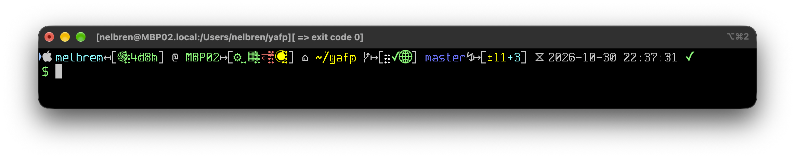

13. ### [D2Coding][preview-d2coding]

    #### ¾ Logos — D2Coding

    |OS|macOS|Windows|Debian|Kali|
    |:--:|:--:|:--:|:--:|:--|
    |==3/4==|✓|✓|==✗==|✓|

    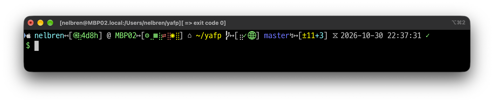

14. ### [Bront DejaVu Sans Mono][preview-bront-dejavu]

    #### ¾ Logos — Bront DejaVu Sans Mono

    |OS|macOS|Windows|Debian|Kali|
    |:--:|:--:|:--:|:--:|:--|
    |==3/4==|✓|✓|==✗==|✓|

    

15. ### [Bront Ubuntu Mono][preview-bront-ubuntu]

    #### ¾ Logos — Bront Ubuntu Mono

    |OS|macOS|Windows|Debian|Kali|
    |:--:|:--:|:--:|:--:|:--|
    |==3/4==|✓|✓|==✗==|✓|

    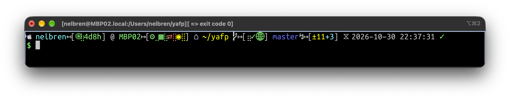

16. ### [IBM 3270][preview-font3270]

    #### ¾ Logos — IBM 3270

    |OS|macOS|Windows|Debian|Kali|
    |:--:|:--:|:--:|:--:|:--|
    |==3/4==|✓|✓|==✗==|✓|

    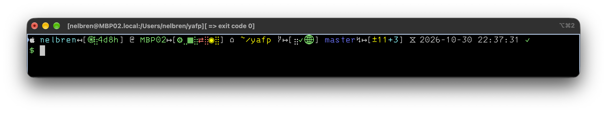

17. ### [Monoid][preview-monoid]

    #### ¾ Logos — Monoid

    |OS|macOS|Windows|Debian|Kali|
    |:--:|:--:|:--:|:--:|:--|
    |==3/4==|✓|✓|==✗==|✓|

    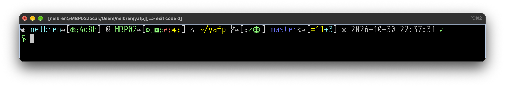

18. ### [Iosevka][preview-iosevka]

    #### ¾ Logos — Iosevka

    |OS|macOS|Windows|Debian|Kali|
    |:--:|:--:|:--:|:--:|:--|
    |==3/4==|✓|✓|==✗==|✓|

    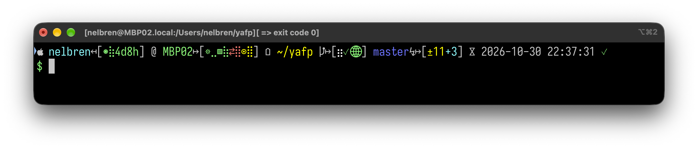

19. ### [Hack][preview-hack]

    #### ¾ Logos — Hack

    |OS|macOS|Windows|Debian|Kali|
    |:--:|:--:|:--:|:--:|:--|
    |==3/4==|✓|✓|==✗==|✓|

    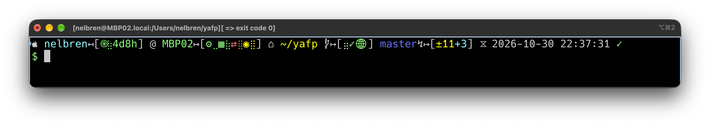

20. ### [Hack Ligatured][preview-hack-ligatured]

    #### ¾ Logos — Hack Ligatured

    |OS|macOS|Windows|Debian|Kali|
    |:--:|:--:|:--:|:--:|:--|
    |==3/4==|==✗==|✓|✓|✓|

    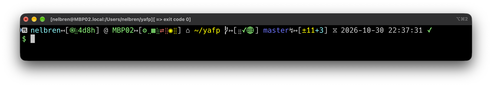

21. ### [Office Code Pro][preview-office-code-pro]

    #### ¾ Logos — Office Code Pro

    |OS|macOS|Windows|Debian|Kali|
    |:--:|:--:|:--:|:--:|:--|
    |==3/4==|✓|✓|==✗==|✓|

    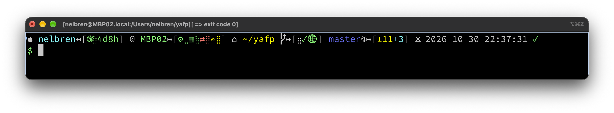

22. ### [Fira Code][preview-firacode]

    #### ¾ Logos — Fira Code

    |OS|macOS|Windows|Debian|Kali|
    |:--:|:--:|:--:|:--:|:--|
    |==3/4==|✓|✓|==✗==|✓|

    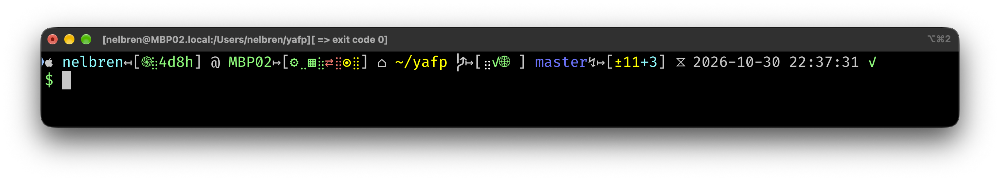

23. ### [Hasklig][preview-hasklig]

    #### ¾ Logos — Hasklig

    |OS|macOS|Windows|Debian|Kali|
    |:--:|:--:|:--:|:--:|:--|
    |==3/4==|✓|✓|==✗==|✓|

    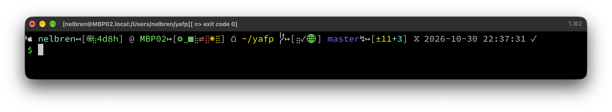

24. ### [mononoki][preview-mononoki]

    #### ¾ Logos — mononoki

    |OS|macOS|Windows|Debian|Kali|
    |:--:|:--:|:--:|:--:|:--|
    |==3/4==|✓|✓|==✗==|✓|

    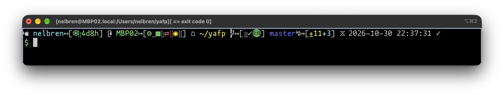

25. ### [Fantasque Sans Mono][preview-fantasque-sans]

    #### ¾ Logos — Fantasque Sans Mono

    |OS|macOS|Windows|Debian|Kali|
    |:--:|:--:|:--:|:--:|:--|
    |==3/4==|✓|✓|==✗==|✓|

    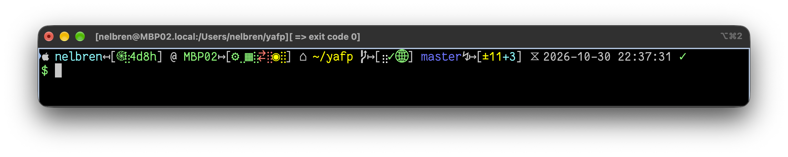

26. ### [Hermit][preview-hermit]

    #### ¾ Logos — Hermit

    |OS|macOS|Windows|Debian|Kali|
    |:--:|:--:|:--:|:--:|:--|
    |==3/4==|✓|✓|==✗==|✓|

    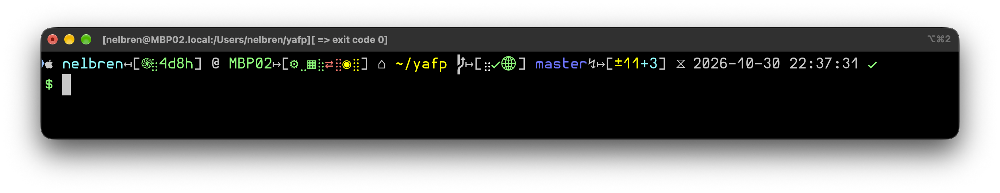

27. ### [Source Code Pro][preview-source-code-pro]

    #### ¾ Logos — Source Code Pro

    |OS|macOS|Windows|Debian|Kali|
    |:--:|:--:|:--:|:--:|:--|
    |==3/4==|✓|✓|==✗==|✓|

    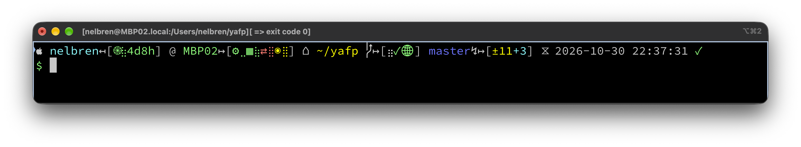

28. ### [Sudo][preview-sudo]

    #### ¾ Logos — Sudo

    |OS|macOS|Windows|Debian|Kali|
    |:--:|:--:|:--:|:--:|:--|
    |==3/4==|✓|✓|==✗==|✓|

    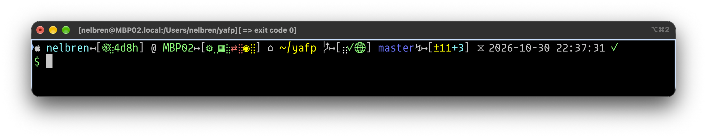

29. ### [Luculent][preview-luculent]

    #### ¾ Logos — Luculent

    |OS|macOS|Windows|Debian|Kali|
    |:--:|:--:|:--:|:--:|:--|
    |==3/4==|✓|✓|==✗==|✓|

    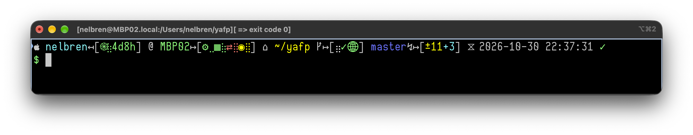

[preview-aporetic-sans]: https://www.programmingfonts.org/#aporetic-sans
[preview-psudo]: https://www.programmingfonts.org/#psudo
[preview-ioskeley]: https://www.programmingfonts.org/#ioskeley
[preview-adwaita-mono]: https://www.programmingfonts.org/#adwaita-mono
[preview-monofoki]: https://www.programmingfonts.org/#monofoki
[preview-julia-mono]: https://www.programmingfonts.org/#julia-mono
[preview-cozette]: https://www.programmingfonts.org/#cozette
[preview-jetbrainsmono]: https://www.programmingfonts.org/#jetbrainsmono
[preview-lilex]: https://www.programmingfonts.org/#lilex
[preview-victor-mono]: https://www.programmingfonts.org/#victor-mono
[preview-proggy-vector]: https://www.programmingfonts.org/#proggy-vector
[preview-spleen]: https://www.programmingfonts.org/#spleen
[preview-d2coding]: https://www.programmingfonts.org/#d2coding
[preview-bront-dejavu]: https://www.programmingfonts.org/#bront-dejavu
[preview-bront-ubuntu]: https://www.programmingfonts.org/#bront-ubuntu
[preview-font3270]: https://www.programmingfonts.org/#font3270
[preview-monoid]: https://www.programmingfonts.org/#monoid
[preview-iosevka]: https://www.programmingfonts.org/#iosevka
[preview-hack]: https://www.programmingfonts.org/#hack
[preview-hack-ligatured]: https://www.programmingfonts.org/#hack-ligatured
[preview-office-code-pro]: https://www.programmingfonts.org/#office-code-pro
[preview-firacode]: https://www.programmingfonts.org/#firacode
[preview-hasklig]: https://www.programmingfonts.org/#hasklig
[preview-mononoki]: https://www.programmingfonts.org/#mononoki
[preview-fantasque-sans]: https://www.programmingfonts.org/#fantasque-sans
[preview-hermit]: https://www.programmingfonts.org/#hermit
[preview-source-code-pro]: https://www.programmingfonts.org/#source-code-pro
[preview-sudo]: https://www.programmingfonts.org/#sudo
[preview-luculent]: https://www.programmingfonts.org/#luculent

<!-- markdownlint-disable MD033 -->
<div style="text-align: right; font-size: 12px;">
📆 2026-11-03 00:16:15 🍎 MBP02 |
֎ OpenAI 🤖 Codex 🧠 GPT-6 Not exposed & 👨🏻‍💻 Nelbren ©️ 2026
</div>
