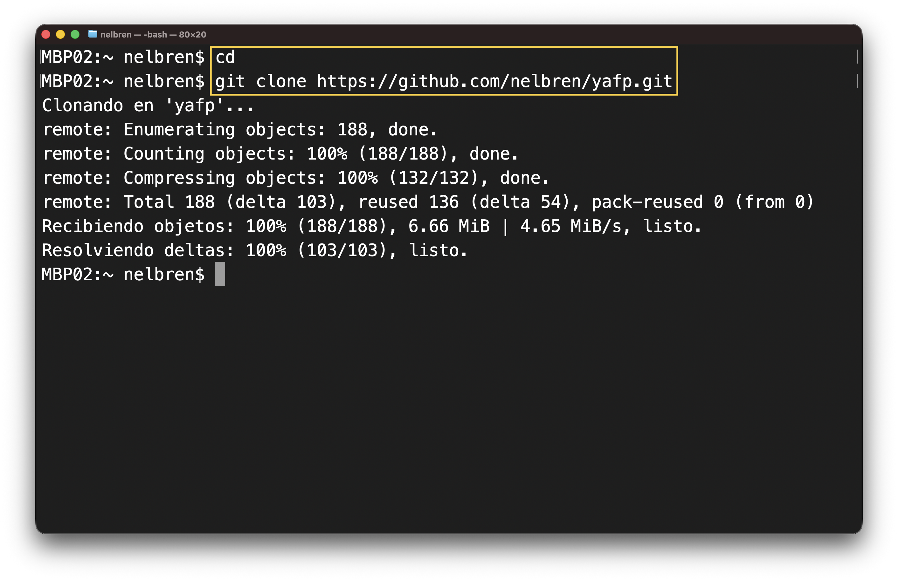
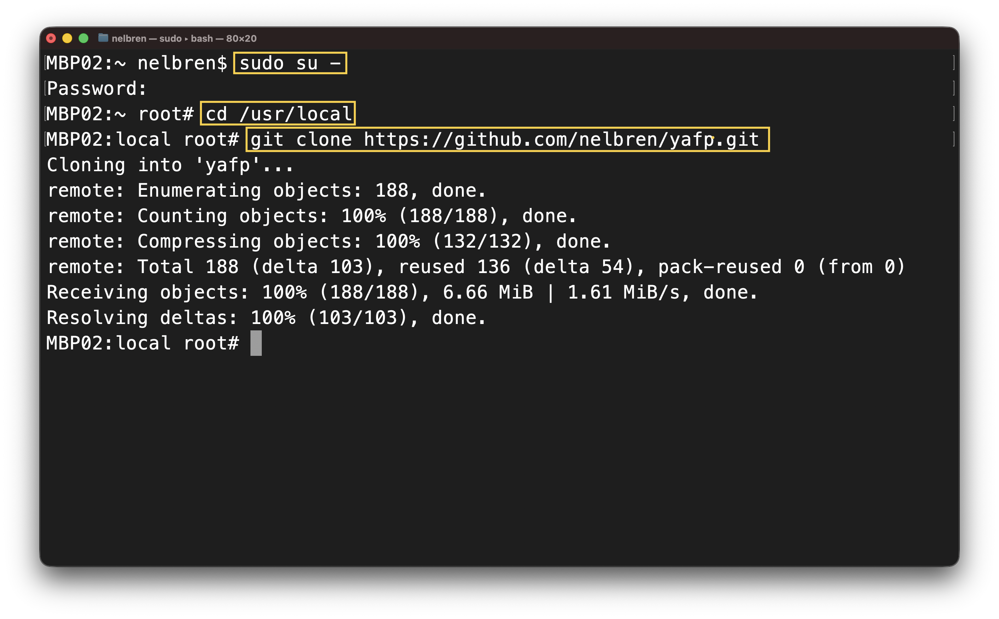
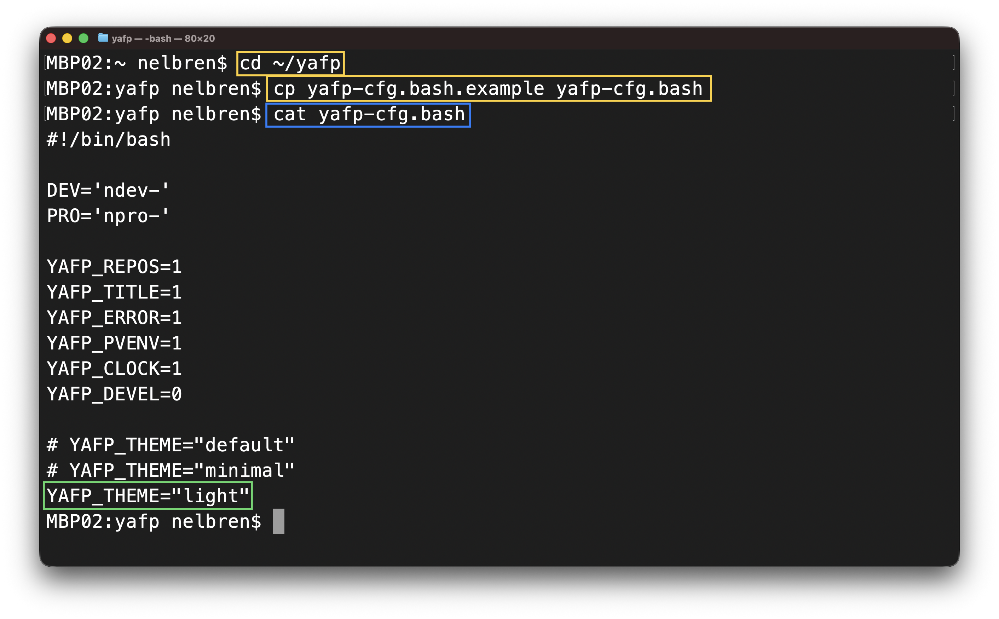
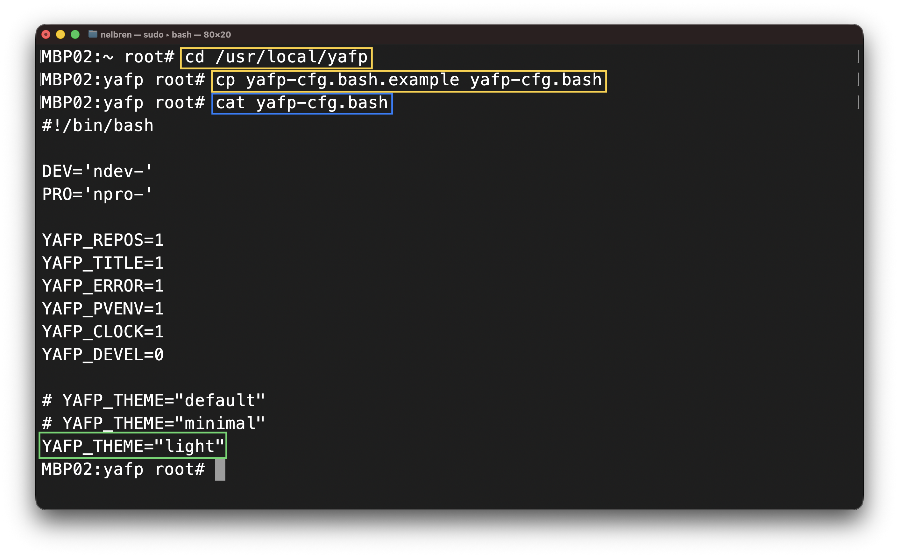
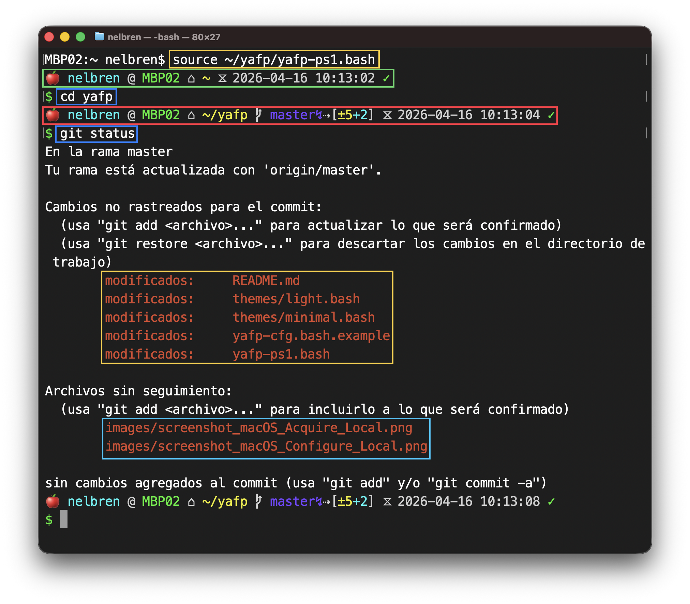
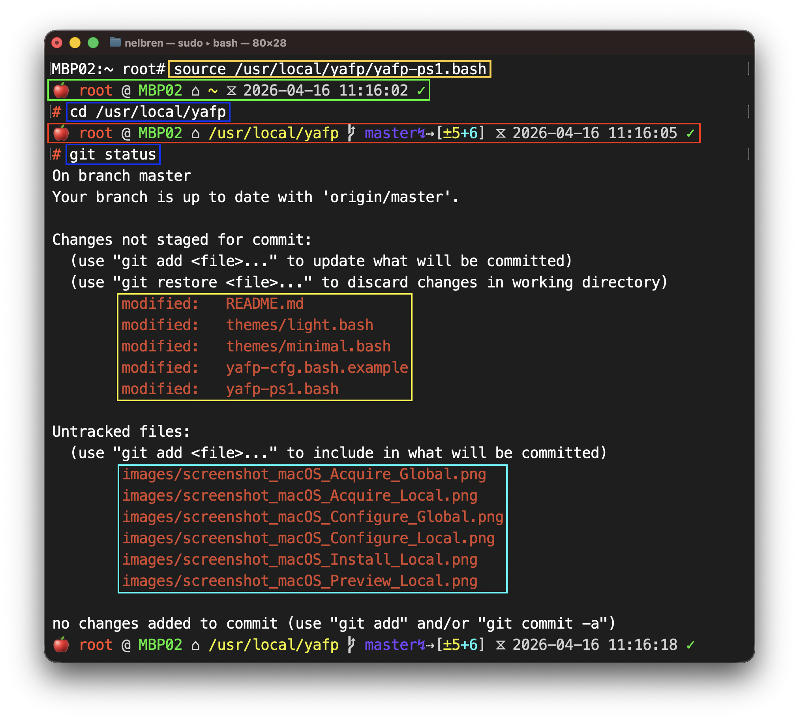
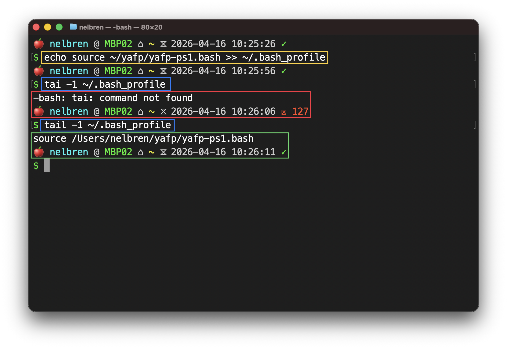
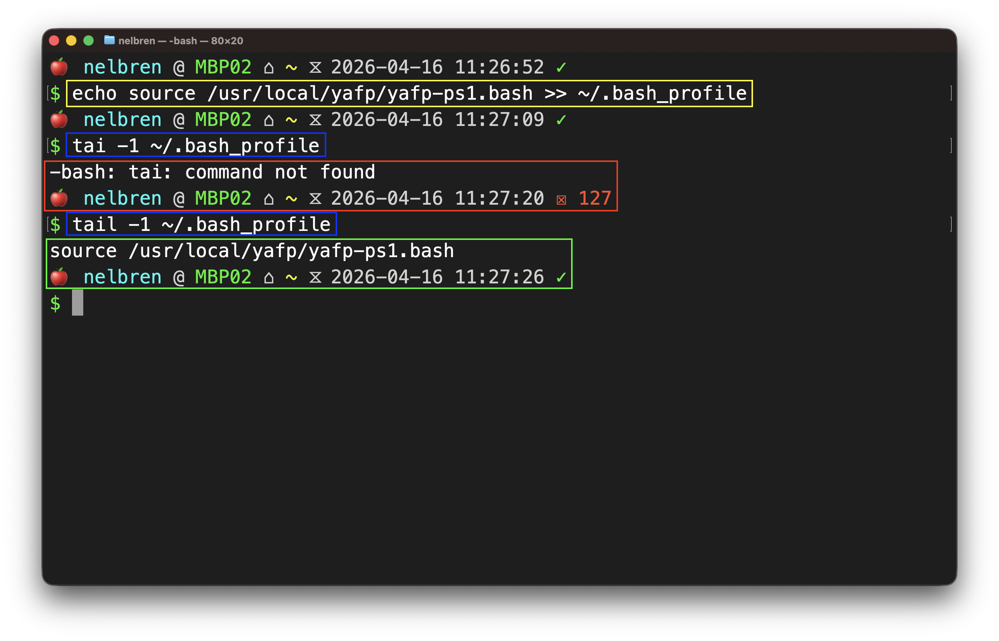

# Installation and updates

[Documentation index](../README.md#guides)

For a first local session, follow the shell commands in the
[quick start](../README.md#quick-start). The examples below cover local and
system-wide Bash installations, shell profiles, updates and reloads.

## Get the source

### 👤 Local acquire

```bash
cd
git clone https://github.com/nelbren/yafp.git
```



### 🌐︎ Global acquire

```bash
sudo su -
cd /usr/local
git clone https://github.com/nelbren/yafp.git
```



## Configure your shell

### 👤 Local Bash settings

```bash
cd ~/yafp
cp yafp-cfg.bash.example yafp-cfg.bash
```



### 🪟 Local PowerShell settings

Create the personal configuration before loading the prompt:

```powershell
Copy-Item yafp-cfg.ps1.example yafp-cfg.ps1
```

Both `yafp-cfg.bash` and `yafp-cfg.ps1` are ignored by Git. Their `.example`
files define the versioned defaults and can be copied again when new options
are introduced.

### 🌐︎ Global settings

```bash
cd /usr/local/yafp
cp yafp-cfg.bash.example yafp-cfg.bash
```



## Preview the prompt

### 👤 Local preview

```bash
source ~/yafp/yafp-ps1.bash
```



### 🌐︎ Global preview

```bash
source /usr/local/yafp/yafp-ps1.bash
```



## Load YAFP in future sessions

### 👤 Local install

```bash
echo source ~/yafp/yafp-ps1.bash >> ~/.bash_profile
```



### 🌐︎ Global install

```bash
echo source /usr/local/yafp/yafp-ps1.bash >> ~/.bash_profile
```



## zsh on macOS and Linux

YAFP supports zsh 5.9 or later alongside Bash and PowerShell. It uses a native
engine and the same `default`, `minimal`, and `light` themes and configuration
options. Git remains optional. The Bash-style assignments in the other guides
also apply to `yafp-cfg.zsh`.

From your YAFP checkout, create the personal configuration:

```zsh
cp yafp-cfg.zsh.example yafp-cfg.zsh
```

Add the following line to your `~/.zshrc`, using your checkout's absolute path:

```zsh
source /path/to/yafp/yafp-ps1.zsh
```

Load it in your existing zsh session with the same command. For a configuration
stored elsewhere, set `YAFP_CONFIG_FILE` to its absolute path before sourcing.
Personal `yafp-cfg.zsh` files are ignored by Git.

If you use Oh My Zsh, set `ZSH_THEME=""` and source YAFP after the framework.
YAFP owns the visible prompt; other successful `precmd`, `preexec`, and
`zshexit` hooks remain registered. It enables `PROMPT_PERCENT` and
`PROMPT_SUBST` and disables `PROMPT_BANG`. Its implementation options, including
array indexing, stay local to YAFP functions. Prompt data is expanded once,
so paths and names containing substitution syntax cannot execute commands.

YAFP also mitigates visual remnants when navigating zsh history entries with
potentially wide emoji or symbol sequences. It requests a full redraw when
entering or leaving such an entry, reusing the cached prompt without changing
the command, its cursor, key bindings, or execution. Detection is conservative:
variation selectors, joined emoji, flags, keycaps, and symbol/emoji ranges are
candidates, rather than proof that a particular terminal displays them wrongly.
Ordinary ASCII and accented Latin history entries keep normal incremental
redrawing. Existing ZLE hooks remain registered, and reloads do not duplicate
YAFP's hooks.

The mitigation is enabled by default. To disable it, add
`YAFP_ZSH_HISTORY_REDRAW=0` to your personal `yafp-cfg.zsh` and run `yafp-reload`.
It addresses history transitions, not zsh's internal Unicode width tables;
cursor positioning while editing an emoji sequence can still differ between
terminals. `Ctrl+L` remains available for a manual screen redraw.

The zsh implementation includes the remote checks, staged and remote banners,
virtual environments, previous-command exit status, execution statistics,
OSC 133, reload, development timing, and the `yafp-*` helper commands.
It does not invoke Bash to render the prompt. Remote workers are silent
and run in the background; the next prompt reads their cached result.

## PowerShell profile

After trying the prompt, add its dot-source command to your PowerShell
`$PROFILE` to load it in new sessions. Use the path to your checkout:

```powershell
. "$HOME/yafp/yafp-ps.ps1"
```

## Startup updates

The first interactive load in each shell session checks the YAFP installation
before showing the prompt, regardless of the current directory. The startup
check is silent when the installation matches its upstream. If a problem or
update is found, a compact frame shows the installation path and the notice.
Its centered title is ` YAFP startup update` in black on bright white.
Startup messages have no enclosing parentheses and use YAFP severity colors:
black on intense yellow for warnings and intense white on red for errors.
Error backgrounds respect `YAFP_DARKC`.
This synchronous check waits for Git;
it does not leave a background job or defer messages to a later prompt.
Normal repository prompt monitoring remains asynchronous and independent.
Reloading YAFP does not repeat the startup check in the same session.
A failed fetch displays `🌐 REMOTE CHECK FAILED`; remote authentication or
configuration errors can produce the same message as an offline connection.

The startup check silently accepts current checkouts and reports ahead,
behind, and diverged states.
It also explains when Git, a commit, a tracking branch, or a remote is missing,
or when HEAD is detached. For example:

```text
┌───────────────────────────────────────────────────────────────────────────┐
│                            YAFP startup update                           │
├───────────────────────────────────────────────────────────────────────────┤
│ YAFP startup check: /home/user/yafp                                       │
│  REMOTE NOT UPDATED: 1 local commit has not been pushed to origin/master │
└───────────────────────────────────────────────────────────────────────────┘
```

When only remote commits are missing, it shows their count and asks in English:

```text
┌─────────────────────────────────────────────────────────────────┐
│                       YAFP startup update                      │
├─────────────────────────────────────────────────────────────────┤
│ YAFP startup check: /home/user/yafp                             │
│  OUTDATED REPOSITORY: YAFP is 3 commit(s) behind its upstream. │
└─────────────────────────────────────────────────────────────────┘
Update YAFP from v0.3.5 to v0.4.0 now? [y/N]
```

Enter, `N`, EOF, or any answer other than `y`/`Y` leaves the checkout alone.
Accepting runs `git pull --ff-only` in the YAFP installation and reloads the
prompt only after success. Divergence displays both local and remote commit
counts without offering an automatic merge. Local changes remain intact; if
they conflict with an accepted update, Git
refuses the pull. Startup reports remote state independently of local edits,
without a separate `UNCOMMITTED CHANGES` line. The normal prompt still shows
local change counters when that checkout is the current directory.
Noninteractive and redirected-input sessions never start the check.

To disable this startup check, set the environment variable before loading:

```bash
export YAFP_UPDATE_CHECK=0
```

```powershell
$env:YAFP_UPDATE_CHECK = '0'
```

## Reload the prompt

Use `yafp-reload` to reload the active Bash, zsh, or PowerShell prompt after
changing its implementation or personal configuration. A successful manual
reload displays a compact ` yafp-reload` confirmation. YAFP also records the
commit from which it was loaded. After a successful `git pull`, it checks
`HEAD` in the YAFP repository and reloads automatically when that hash changes.
Pulling another repository leaves that hash unchanged. Disable only the
automatic behavior with:

```bash
YAFP_AUTO_RELOAD=0
```

```powershell
$global:YAFP_AUTO_RELOAD = 0
```

## Earlier platform screenshots

Earlier platform screenshots show the previous icon set:
[Linux](images/linux.png), [macOS Bash](images/apple_bash.png),
[Cygwin](images/windows_cygwin.png),
[Git Bash](images/windows_git_bash.png) and
[PowerShell on Windows](images/windows_powershell.png).
